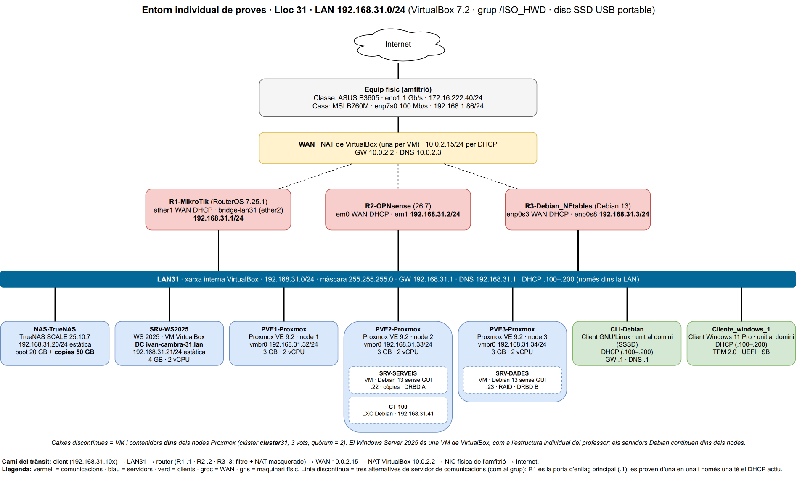

# Naix un sistema: instal·la, configura i vigila'l · Part individual

**Alumne:** Ivan · **Lloc:** 31 · **LAN:** `192.168.31.0/24` · **Curs:** 1r ASIX (ISO + FDM)
**Lliurament de la documentació:** 22/11/2026 · **Prova individual:** 25/11/2026

Entorn individual en VirtualBox (SSD USB portable, funciona a classe i a casa) que reprodueix el disseny del [grup 3](https://github.com/varo010/asix-aula-grup-03-ISO): 3 routers, NAS, clúster Proxmox de 3 nodes, Windows Server 2025 amb domini i clients Windows i Linux.



## Tasques

| Tasca | Contingut | Accions | Estat |
|---|---|---|---|
| [Tasca 0 · Entorn](Tasca0-Entorn/) | VM, recursos, càlculs i problemes resolts | a17, a18, a127 | ✅ |
| Tasca 1 | Només de grup | — | ➖ |
| [Tasca 2 · Inventari](Tasca2-Inventari/) | Inventari dels dos equips, tests i colls de botella | a19–a21, a27–a29 | ✅ |
| Tasca 3 | Només de grup | — | ➖ |
| [Tasca 4 · Xarxa](Tasca4-Xarxa/) | Esquema, configuració de cada interfície i proves | a128, a129, a148, a149 | ✅ |
| [Tasca 5 · Sistemes](Tasca5-Sistemes/) | Routers, NAS, Proxmox, Windows Server i domini, Linux, clients, còpies | a78, a79, a105, a203–a259 | ✅ |
| [Tasca 6 · RAID](Tasca6-RAID/) | RAID 0/1/5/10 i espill DRBD entre equips | a102, a103, a107–a109 | ✅ |
| [Tasca 7 · Rendiment](Tasca7-Rendiment/) | Mesures, capacitat de l'equip i optimitzacions | a22–a24, a119–a125 | ✅ |
| [Tasca 8 · Cas final](Tasca8-CasFinal/) | Preparació de la prova del 25/11 | a25, a26, a50–a53, a80, a104, a122 | ⏳ 25/11 |

**Rúbrica individual:** 69 de 78 accions Apte i 13 de 18 Apte+; totes les que falten són de la prova del 25/11 → [`rubrica/`](rubrica/).

## Estructura

```
TascaN-.../         una carpeta per tasca
  README.md         el document de la tasca
  evidencies/       registres de text i captures (MAC tapades)
  scripts/ config/  el que s'ha fet servir per a la tasca
Tasca5-Sistemes/    una subcarpeta per sistema (0-Comprovacions … 9-Copies)
rubrica/            rúbrica, estat i seguiment
ia-log.md           registre d'ús d'IA (proposta, contrast i decisió)
```

## Notes

- **Canvi de lloc (17/11):** el lloc correcte és el 31. Tot es va passar de 192.168.13.0/24 a **192.168.31.0/24** ([Tasca 4](Tasca4-Xarxa/README.md#4-canvi-de-lloc-13--31)). Les evidències anteriors al 17/11 mostren l'adreçament antic: són reals i no s'han modificat.
- **Credencials:** no n'hi ha cap al repositori.
- **IA:** l'ús d'IA està registrat a [`ia-log.md`](ia-log.md).
