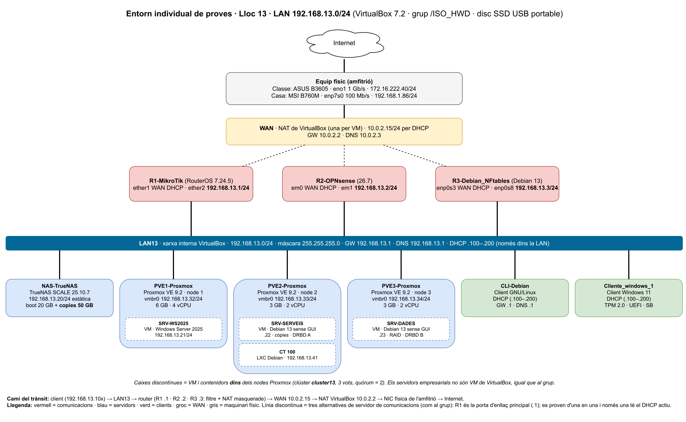

# Naix un sistema: instal·la, configura i vigila'l — Part individual

**Alumne:** Ivan · **Lloc a l'aula:** 13 · **LAN:** `192.168.13.0/24` · **Curs:** 1r ASIX · ISO + FDM
**Enunciat:** ASIX ThinkLab V2.0 (19/10/2026) · **Lliurament documentació:** diumenge 22/11/2026 · **Final individual:** dimecres 25/11/2026

> Reprodueix el disseny del grup 3 ([asix-aula-grup-03-ISO](https://github.com/varo010/asix-aula-grup-03-ISO)) amb la LAN 192.168.13.0/24.
>
> L'entorn de proves viu en un **SSD USB extern** (Linux Mint 22.3 + VirtualBox 7.2.18) que s'arranca
> indistintament a l'**equip de classe** i a l'**equip de casa**. El sistema i les VM són els mateixos;
> el que canvia és el maquinari amfitrió. Per això el disseny es dimensiona per a l'equip més limitat.



## Índex de la documentació

| Doc | Tasca | Contingut | Mòdul-RA |
|---|---|---|---|
| [01-entorn](docs/01-entorn.md) | T0 | Entorn de proves, recursos, taula de VM, limitacions, problemes i solucions | FDM RA1 |
| [02-inventari](docs/02-inventari.md) | T2 | Inventari classe vs casa, colls de botella, solucions i tests | FDM RA1 |
| [03-xarxa](docs/03-xarxa.md) | T4 | Esquema de xarxa, configuració de cada interfície, connectivitat | ISO RA1 |
| [04-installacio](docs/04-installacio.md) | T5 | Instal·lació i configuració de cada sistema, còpies i recuperacions | ISO RA1 / RA3 / RA6 |
| [05-raid](docs/05-raid.md) | T6 | RAID 0/1/5/10 amb mdadm i espill entre equips amb DRBD | ISO RA3 |
| [06-rendiment](docs/06-rendiment.md) | T7 | Línia base, càrregues de VM, saturació, capacitat i optimitzacions | FDM RA1 / ISO RA6 |
| [07-cas-final](docs/07-cas-final.md) | T8 | Mètode d'incidències, full de comandes i estudi per RA (inclou FDM RA4) | totes |
| [ia-log](docs/ia-log.md) | — | Registre d'ús d'IA: proposta, contrast i decisió | — |
| [CAPTURES](evidencias/CAPTURES.md) | — | **Índex de totes les captures de pantalla**, per tasca, amb què demostra cadascuna | — |

## Estructura del repositori

```
docs/          documentació en Markdown (un fitxer per tasca)
diagrames/     esquema de xarxa (.drawio editable + .png)
evidencias/    registres comentats, una carpeta per tasca i sistema; les imatges, a <tasca>/captures/ (índex: evidencias/CAPTURES.md)
configs/       configuracions dels sistemes (nftables, MikroTik, DRBD...) sense credencials
scripts/       host/ (inventari, tests, mesures) · vbox/ (entorn i diagrama) · proxmox/ · clients/ (W11) · copies/ · raid/ · rubrica/
rubrica/       rúbrica original, rúbrica amb les marques, estat.json i fitxer de seguiment
```

## Estat respecte a la rúbrica individual

Llegenda: ✅ fet amb evidència · 🟡 preparat (disseny/scripts llestos, falta executar-ho i capturar-ho) · ⬜ pendent · ➖ no exigit (desactivat a la rúbrica)

| Tasca | Accions | Estat | On |
|---|---|---|---|
| T0 Entorn (Apte) | a17, a18 | ✅ entorn muntat i funcionant ([VM del grup](evidencias/t0-entorn/vms.txt)) | [01](docs/01-entorn.md) |
| T0 Entorn (Apte+) | a127 | ✅ 11 problemes documentats amb causa i solució (s'hi afegeixen els nous) | [01 §5](docs/01-entorn.md#5-problemes-trobats-i-solució-a127) |
| T2 Inventari (Apte) | a19, a20, a21 | ✅ classe i casa complets (amb sudo) | [02](docs/02-inventari.md) |
| T2 Tests (Apte+) | a27, a28, a29 | ✅ classe i casa (memtester, dd, fio, xarxa) | [02](docs/02-inventari.md) |
| T4 Xarxa (Apte) | a128, a148 | ✅ esquema i taula d'interfícies (alineats amb el grup) | [03](docs/03-xarxa.md) |
| T4 Xarxa (Apte+) | a129, a149 | ✅ ping, traceroute, rutes, interfícies i aïllament | [03](docs/03-xarxa.md) |
| T5 General | a78, a79, a258, a259 | 🟡 a78 ✅ (5 de 6 ISO verificades, W11 justificada) · a258 ✅ (incidència de GRUB) · a259 ✅ · a79: falten R1, R2, R3 i W11 | [04](docs/04-installacio.md) |
| T5 MikroTik | a203–a209 | ✅ complet (recuperació en 42 s) | [04 §2](docs/04-installacio.md#2-r1--mikrotik-routeros-a203a209) |
| T5 OPNsense | a210–a216 | ✅ complet (recuperació en 48 s) | [04 §3](docs/04-installacio.md#3-r2--opnsense-a210a216) |
| T5 nftables | a217–a223 | ✅ complet (recuperació en 22 s) · els 3 routers configurats igual | [04 §4](docs/04-installacio.md#4-r3--debian-13--nftables-a217a223) |
| T5 TrueNAS | a224–a227 | ✅ complet (pool `copies`, SSH/NFS/SMB) | [04 §5](docs/04-installacio.md#5-nas--truenas-scale-a224a227-a259) |
| T5 Proxmox | a228–a232, a235, a236 | ✅ 3 nodes, clúster, NFS compartit, VM 220/230, CT 100, migració (8,5 s en calent) i còpies | [04 §6](docs/04-installacio.md#6-proxmox-ve-a228a232-a235-a236) |
| T5 Windows Server 2025 | a237–a241 | ⬜ **falta la ISO** · anirà com a VM 210 dins de PVE1 | [04 §7](docs/04-installacio.md#7-windows-server-2025-a237a241) |
| T5 Linux infra | a242–a246 | ✅ VM 220 (PVE2) i 230 (PVE3): actualitzades, usuaris, SSH només amb clau, còpia al NAS amb prova de restauració | [04 §8](docs/04-installacio.md#8-servidors-gnulinux-dinfraestructura-a242a246) |
| T5 Clients | a247–a250, a252–a255 | 🟡 W11 Pro ✅ (a247–a250) · CLI-Debian ✅ (a252–a255) · Guest Additions als dos | [04 §9](docs/04-installacio.md#9-clients-a247a250-a252a255) |
| T5 Apte+ còpies automàtiques | a105 | ✅ imatges: tasca setmanal de Proxmox provada · 🟡 configuracions: orquestrador instal·lat, falta repartir la clau | [04 §10](docs/04-installacio.md#10-apte-còpies-automatitzades-a105) |
| T6 RAID (Apte) | a102, a103 | ✅ RAID 0, 1, 5 (amb spare) i 10 a la VM 230: fallada, integritat i reconstrucció | [05](docs/05-raid.md) |
| T6 Espill entre equips (Apte+) | a107, a108, a109 | ✅ DRBD entre VM 220 (PVE2) i 230 (PVE3): failover en 7,3 s sense perdre dades | [05](docs/05-raid.md#tasca-63--espill-entre-dos-equips-a107a109) |
| T7 Rendiment (Apte) | a22, a23, a24, a119, a120, a121 | ✅ 9 escenaris mesurats a casa: el límit és la **RAM** (9 VM sense el WS2025; amb el WS2025 hi ha swap) | [06](docs/06-rendiment.md) |
| T7 Optimitzacions (Apte+) | a123, a124, a125 | ✅ opt. 1: R3 −65 % de RAM · opt. 2: CLI-Debian 26 → 20 serveis i 8 → 2 ports | [06](docs/06-rendiment.md#optimitzacions-apte-a123a125) |
| T8 Final (Apte) | a25, a26, a50–a53, a80, a104, a122 | ⬜ el dia 25/11 | [07](docs/07-cas-final.md) |
| T8 Qüestionari (Apte+) | a30, a57, a84, a110, a126 | ⬜ estudi preparat | [07](docs/07-cas-final.md) |
| No exigides | a54–a56, a81–a83, a106, a251, a256 | ➖ | — |

## Rúbrica d'autoavaluació

- [`rubrica/Rubrica-autoavaluacio-Individual-Ivan.html`](rubrica/Rubrica-autoavaluacio-Individual-Ivan.html): la rúbrica del professorat amb les marques actuals (s'obri al navegador).
- [`rubrica/seguiment-individual-Ivan.txt`](rubrica/seguiment-individual-Ivan.txt): fitxer de seguiment. Des de la rúbrica, **Obri fitxer** carrega les marques i les observacions de cada tasca.
- Es regeneren totes dues a partir de [`rubrica/estat.json`](rubrica/estat.json) amb `python3 scripts/rubrica/actualitza-rubrica.py`.
- Només es marca com a «Feta correctament» el que té evidència al repositori.

## Regles del repositori
- **Cap credencial** al repositori: les contrasenyes reals es guarden fora (gestor de contrasenyes). Als fitxers apareixen com `<...>`.
- Cada captura o registre d'`evidencias/` es cita des del document que el justifica, amb una frase de què demostra.
- Les dades no comprovades es marquen **N/C** amb la prova que les confirmaria.
- L'ús d'IA es registra a [docs/ia-log.md](docs/ia-log.md).
