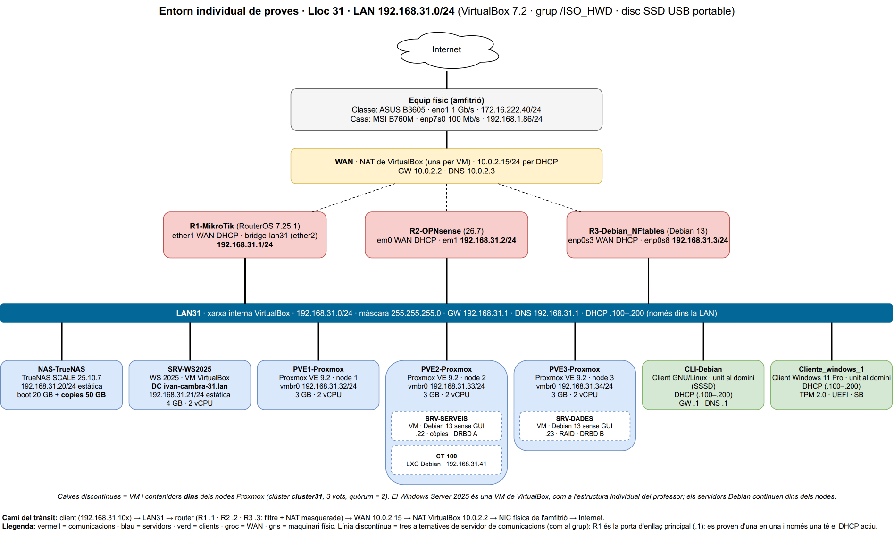

# Tasca 4 · Esquema i configuració de la xarxa

**ISO RA1** · a128, a148 (Apte), a129, a149 (Apte+) · Estat: ✅

**Lloc 31 → LAN `192.168.31.0/24`.** Mateixos rangs i últims octets que el [grup 3](https://github.com/varo010/asix-aula-grup-03-ISO), amb el tercer octet 31.

Font editable: [`esquema/xarxa-individual-lloc31.drawio`](esquema/xarxa-individual-lloc31.drawio).

## 1. Decisions de disseny (a128)

| Rang | Ús |
|---|---|
| .1 – .15 | Routers: R1 .1 · R2 .2 · R3 .3 |
| .16 – .99 | IP fixes: NAS .20 · WS2025 .21 · Linux .22/.23 · nodes .32–.34 · CT .41 |
| .100 – .200 | Clients per DHCP |

| Decisió | Escollida | Per què |
|---|---|---|
| WAN dels routers | NAT de VirtualBox | No toca la xarxa de l'aula ni la de casa; funciona igual als dos equips |
| LAN | Xarxa interna `LAN31` | Aïllada: l'única eixida és el router (es pot comprovar el filtre) |
| IP dels routers | Una per router (.1, .2, .3) | Poden conviure encesos sense conflicte |
| DHCP | Només al router actiu | Dos DHCP a la mateixa LAN es contradiuen |
| DNS | El router (1.1.1.1 / 9.9.9.9); el domini `ivan-cambra-31.lan` es reenvia al DC (.21) | Un sol punt de configuració; Internet no depén del servidor Windows |

## 2. Configuració de cada interfície (a148)

Màscara /24 a tota la LAN. WAN: 10.0.2.15/24, porta d'enllaç 10.0.2.2.

| Equip | Interfície | IP | Porta d'enllaç | DNS | Mètode |
|---|---|---|---|---|---|
| R1-MikroTik | ether1 (WAN) · **bridge-lan31** (ether2) | 10.0.2.15 · **192.168.31.1** | 10.0.2.2 | — | DHCP · estàtica + servidor DHCP |
| R2-OPNsense | em0 (WAN) · em1 (LAN) | 10.0.2.15 · **192.168.31.2** | 10.0.2.2 | — | DHCP · estàtica |
| R3-nftables | enp0s3 (WAN) · enp0s8 (LAN) | 10.0.2.15 · **192.168.31.3** | 10.0.2.2 | — | DHCP · estàtica |
| NAS-TrueNAS | enp0s3 | 192.168.31.20 | .1 | .1 | estàtica |
| SRV-WS2025 | Ethernet 2 | 192.168.31.21 | .1 | 127.0.0.1 i .1 (és el DC) | estàtica |
| PVE1 / PVE2 / PVE3 | vmbr0 (sobre nic0) | .32 / .33 / .34 | .1 | .1 | estàtica |
| ↳ VM 220 / VM 230 / CT 100 | eth0 (cloud-init) | .22 / .23 / .41 | .1 | .1 | estàtica |
| CLI-Debian · W11 | enp0s3 · Ethernet | .100–.200 | router actiu | router actiu | DHCP |

**Camí del trànsit:** client → `LAN31` → router (filtre: tot permés menys tcp/22 + NAT) → NAT de VirtualBox → NIC física → Internet. Les VM dels nodes surten pel bridge `vmbr0` (NIC promíscua). Des d'Internet no es pot iniciar res cap a la LAN (doble NAT i entrada WAN descartada).

## 3. Comprovació (Apte+ · a129, a149)

| Prova | Resultat | Evidència |
|---|---|---|
| Interfícies i rutes de cada equip | ✅ `default via .1` (routers: via 10.0.2.2) | [`ifaces-rutes-*.txt`](evidencies/) |
| Ping dins la LAN (R1, NAS, nodes) | ✅ 0 % de pèrdua | [`ping-lan-i-internet.txt`](evidencies/ping-lan-i-internet.txt) |
| DNS i traceroute | ✅ salt 1 = .1, salt 2 = 10.0.2.2 | — |
| Prova que ha de fallar: SSH cap a Internet | ✅ bloquejada i registrada | [Tasca 5 · R1](../Tasca5-Sistemes/1-R1-MikroTik/) |
| Aïllament: l'amfitrió no arriba a la LAN | ✅ 100 % de pèrdua | [`aillament-amfitrio.txt`](evidencies/aillament-amfitrio.txt) |
| **Xarxa .31 després del canvi de lloc** | ✅ ping a R1, NAS i DC; DNS del domini; HTTPS | [`canvi-lloc31/xarxa-r1-cli-31.txt`](evidencies/canvi-lloc31/xarxa-r1-cli-31.txt) |

**Gestió:** les webs de gestió (Proxmox, TrueNAS, OPNsense, MikroTik) s'obrin des de **CLI-Debian**, dins de la LAN. L'amfitrió no hi té accés directe; com a suport, túnel SSH per R1.

## 4. Canvi de lloc 13 → 31

El 17/11 es va corregir el número de lloc: tot el muntatge va passar de 192.168.13.0/24 a **192.168.31.0/24**, amb els mateixos últims octets. Abans es van fer instantànies `abans-canvi-31` de les 10 VM.

| Element | Què es va canviar |
|---|---|
| VirtualBox | Xarxa interna `LAN13` → `LAN31` a les 10 VM |
| R1 | Bridge, DHCP, NAT, serveis i identitat. IP temporal .13.254 per arribar a la resta durant el canvi (esborrada) |
| NAS | IP amb *rollback* de TrueNAS, passarel·la, DNS i xarxa del NFS |
| Proxmox | `corosync.conf` (IP i nom **cluster31**), `storage.cfg`, xarxa dels nodes, cloud-init de les VM, DRBD |
| R2 / R3 | `config.xml` · `interfaces`, `nftables.conf`, `dnsmasq` |
| WS2025 i clients | IP fixa del servidor, DHCP als clients, domini refet com `ivan-cambra-31.lan` |

Les evidències anteriors al 17/11 (en altres carpetes) mostren 192.168.13.x: són sortides reals i no s'han modificat. Les noves: [`evidencies/canvi-lloc31/`](evidencies/canvi-lloc31/).
