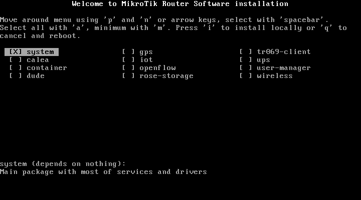
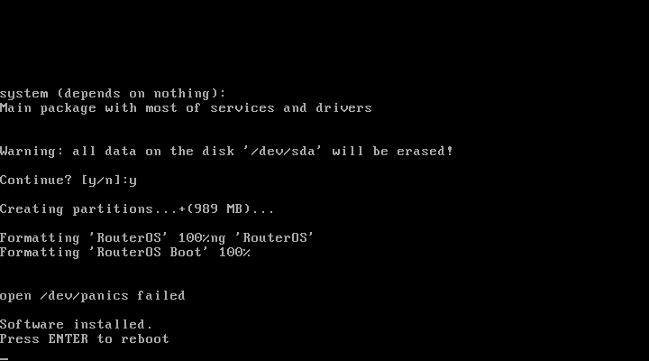
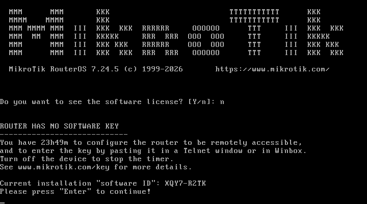
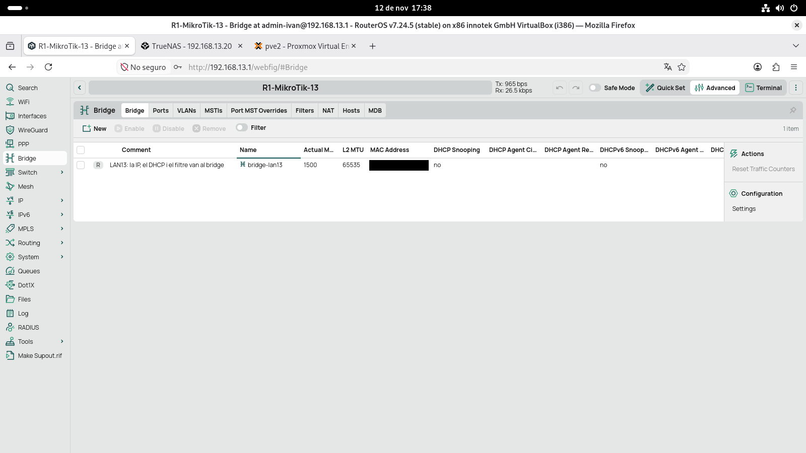
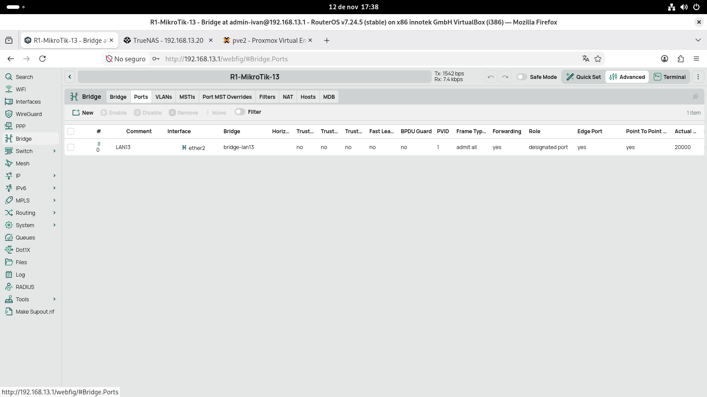
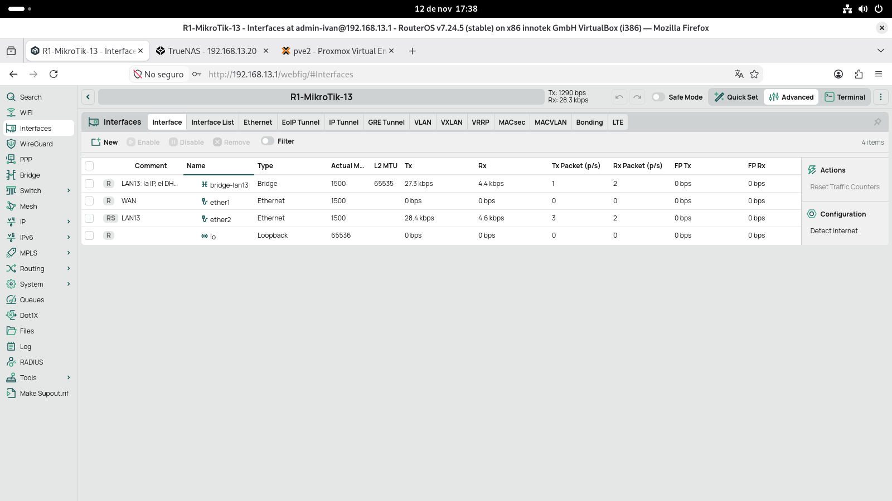
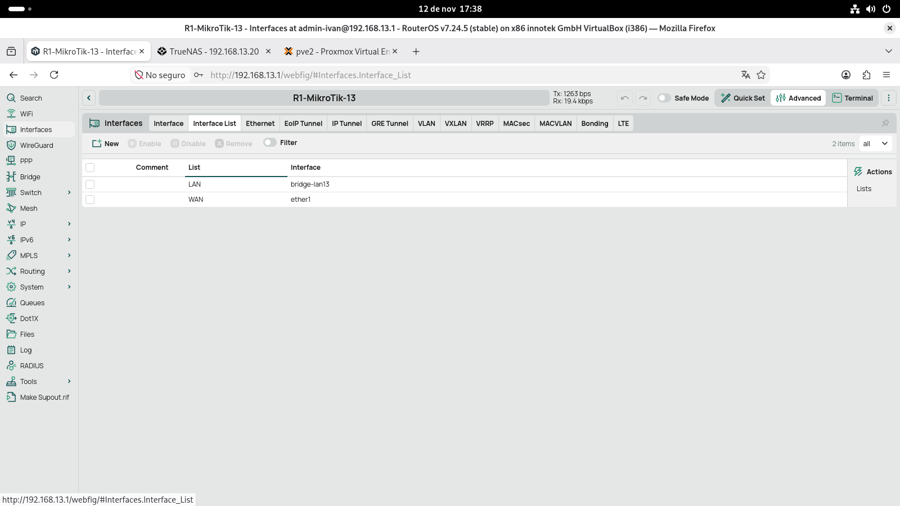
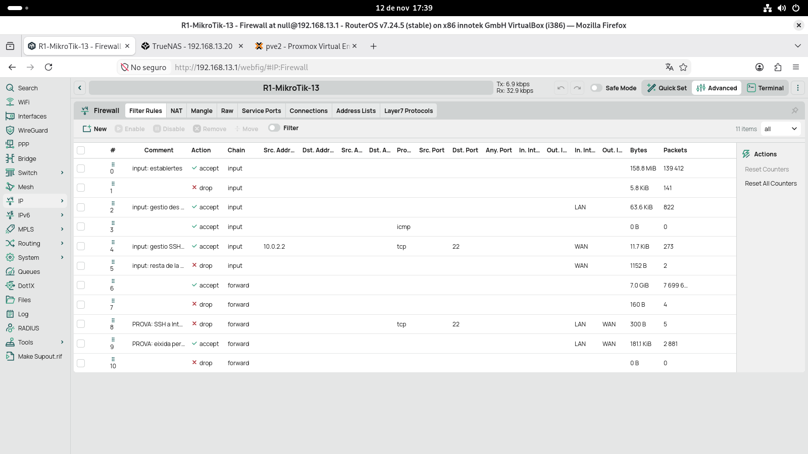

# R1 · MikroTik RouterOS (router principal)

**a203–a209** · Estat: ✅ · Configuració: [`config/r1-config.rsc`](config/r1-config.rsc)

| | |
|---|---|
| Versió | RouterOS **7.25.1** x86 (instal·lat amb la 7.24.5; llicència de prova de 24 h de funcionament) |
| Xarxa | WAN `ether1` per DHCP (10.0.2.15) · LAN **`bridge-lan31`** (port ether2) **192.168.31.1/24** · servidor DHCP .100–.200, domini `lan31.local` |
| Usuaris | `admin-ivan` (full) · `suport` (només lectura) · `admin` desactivat |
| Gestió | SSH des de l'amfitrió per la redirecció 127.0.0.1:2201 (només des de 10.0.2.2); R1 fa de bastió cap a la LAN |

| Acció | Resultat | Evidència |
|---|---|---|
| a203 instal·lació i versió | ✅ paquet `system`, x86_64 | — |
| a204 usuaris | ✅ `admin-ivan` i `suport`; `admin` desactivat | — |
| a205 xarxa | ✅ WAN per DHCP, LAN estàtica al bridge | — |
| a206 Internet per a la LAN | ✅ NAT masquerade + DHCP | — |
| a207 permesa / bloquejada | ✅ HTTPS permés (`R1-FWD-OK`); SSH cap a Internet bloquejat i registrat (`R1-BLOQ-SSH`) | [`a207-prova-permesa-bloquejada.txt`](evidencies/a207-prova-permesa-bloquejada.txt) |
| a208 còpia al NAS | ✅ `/export` + `/system backup` (xifrat) per SFTP a `routers/r1` | — |
| a209 fallada i recuperació | ✅ s'esborren IP de LAN i NAT → `backup load` des del NAS: **42 s** sense servei | [`a209-fallada-recuperacio.txt`](evidencies/a209-fallada-recuperacio.txt) |
| a79 actualització | ✅ 7.24.5 → 7.25.1 (la llicència de prova no deixa actualitzar: còpia, reinstal·lació des de la ISO verificada i `backup load`) | [Comprovacions](../0-Comprovacions/) |

**Bridge a la LAN:** la IP, el DHCP i el filtre van al bridge i les regles usen les llistes `LAN`/`WAN`. Així un port nou queda protegit sense tocar regles i l'accés per MAC no respon per la WAN (igual que el MikroTik del grup).

**Domini:** R1 reenvia les consultes de `ivan-cambra-31.lan` al controlador de domini (.21).

## Captures

Captures reals de les VM (MAC tapades). Les fetes abans del 17/11 mostren l'adreçament antic 192.168.13.x.

| Captura | Què demostra |
|---|---|
|  | a203: instal·lador de RouterOS 7.24.5 amb el paquet `system` |
|  | a203: instal·lació acabada |
|  | a203: llicència x86 sense clau (24 h de funcionament) |
|  | Bridge `bridge-lan13` de la LAN (WebFig) |
|  | `ether2` és l'únic port del bridge |
|  | Interfícies: `ether2` marcada com a esclava (`S`) del bridge |
|  | Llistes d'interfícies: LAN = `bridge-lan13`, WAN = `ether1` |
|  | a207: regles del tallafocs amb les llistes LAN/WAN; la regla «PROVA: SSH a Internet» compta 5 paquets bloquejats |
