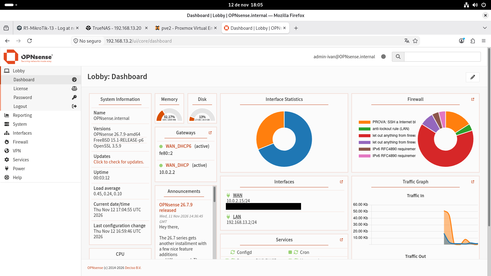
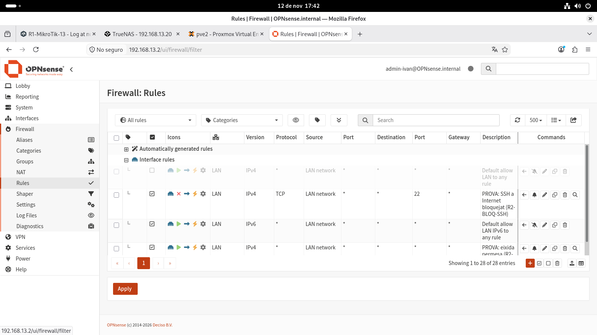
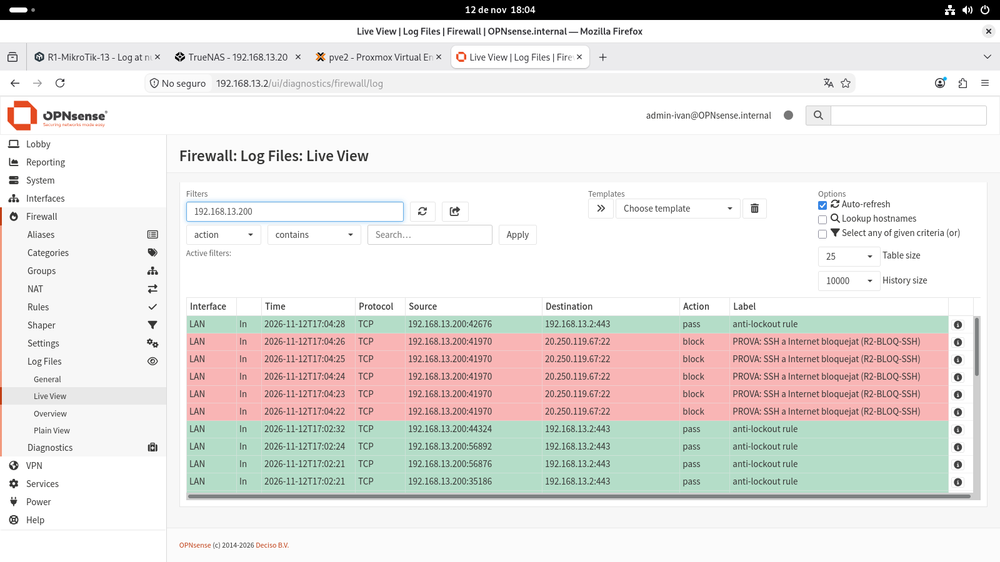
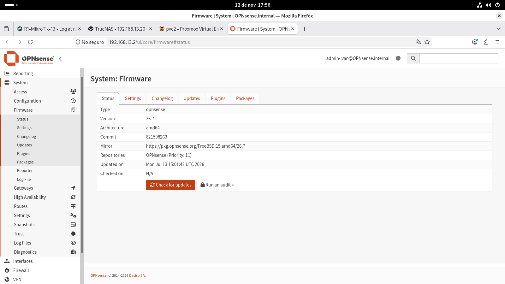
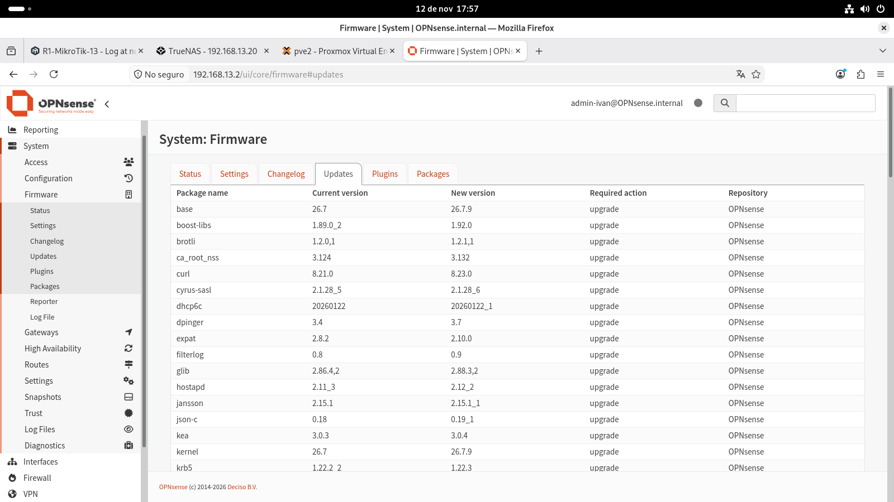
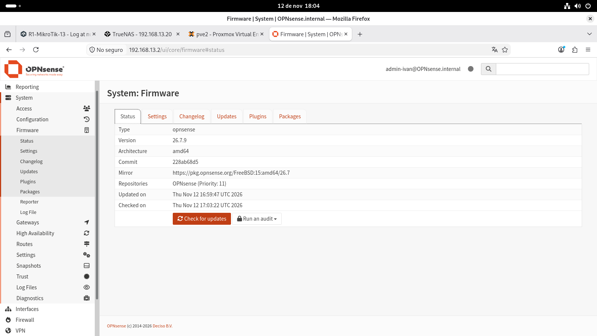
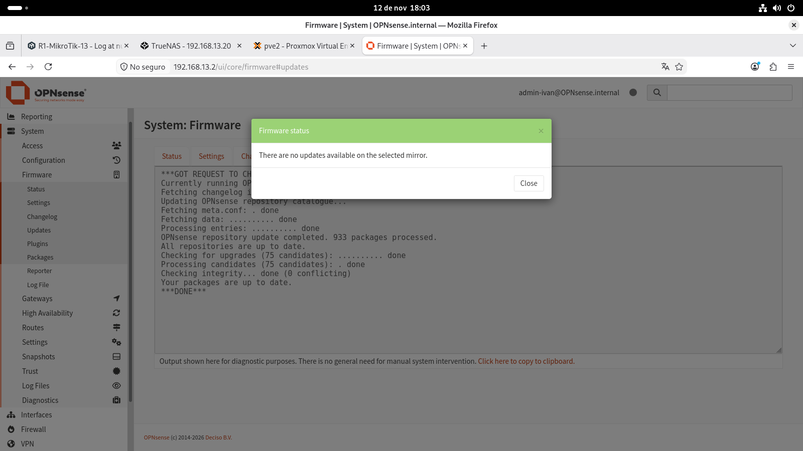

# R2 · OPNsense (router alternatiu)

**a210–a216** · Estat: ✅

| | |
|---|---|
| Versió | OPNsense **26.7.9** (UFS; ZFS gasta massa RAM amb 2 GB) |
| Xarxa | WAN `em0` per DHCP · LAN `em1` **192.168.31.2/24** · DHCP preparat però desactivat (el dona R1) |
| Usuaris | `root` · `admin-ivan` (admins) · `suport` |

| Acció | Resultat | Evidència |
|---|---|---|
| a210–a213 instal·lació, usuaris, xarxa, Internet | ✅ Outbound NAT automàtic; client amb `HTTP/2 200` | [`a210-a214-opnsense.txt`](evidencies/a210-a214-opnsense.txt) |
| a214 permesa / bloquejada | ✅ mateixa política que R1: *block* tcp/22 + *pass* la resta, tots dos amb registre; «Default allow LAN» desactivada | ídem |
| a215 còpia al NAS | ✅ `config.xml` a `routers/r2` (porta hash de contrasenyes: només al NAS) | — |
| a216 fallada i recuperació | ✅ s'esborren les regles de LAN → es restaura `config.xml`: **48 s** | [`a216-fallada-recuperacio.txt`](evidencies/a216-fallada-recuperacio.txt) |
| a79 actualització | ✅ 26.7 → 26.7.9 (96 paquets, 4 avisos de seguretat) | captures 04–07 |

**Problemes:** interfícies assignades al revés a l'instal·lador (corregit amb l'opció 1 de la consola) i el sistema es penjava per **TRIM** (`--discard off` al disc).

## Captures

Captures reals de les VM (MAC tapades). Les fetes abans del 17/11 mostren l'adreçament antic 192.168.13.x.

| Captura | Què demostra |
|---|---|
|  | a210/a212: OPNsense **26.7.9** (després d'actualitzar), WAN 10.0.2.15 i LAN 192.168.13.2 |
|  | a214: regles de la LAN: «Default allow» desactivada, bloqueig de tcp/22 (R2-BLOQ-SSH) i eixida permesa |
|  | a214: registre en viu filtrat pel client .200, ja amb la 26.7.9: connexions SSH **bloquejades** per R2-BLOQ-SSH (vermell). L'HTTPS permés per R2 funciona (HTTP 200) però no apareix amb l'etiqueta R2-FWD-OK: pendent d'investigar |
|  | a79: firmware **abans**: 26.7, mai comprovat |
|  | a79: 96 actualitzacions (`base` i `kernel` 26.7 → 26.7.9, amb 4 avisos de seguretat) |
|  | a79: firmware **després**: 26.7.9 |
|  | a79: nova comprovació: «no hi ha actualitzacions disponibles» |
