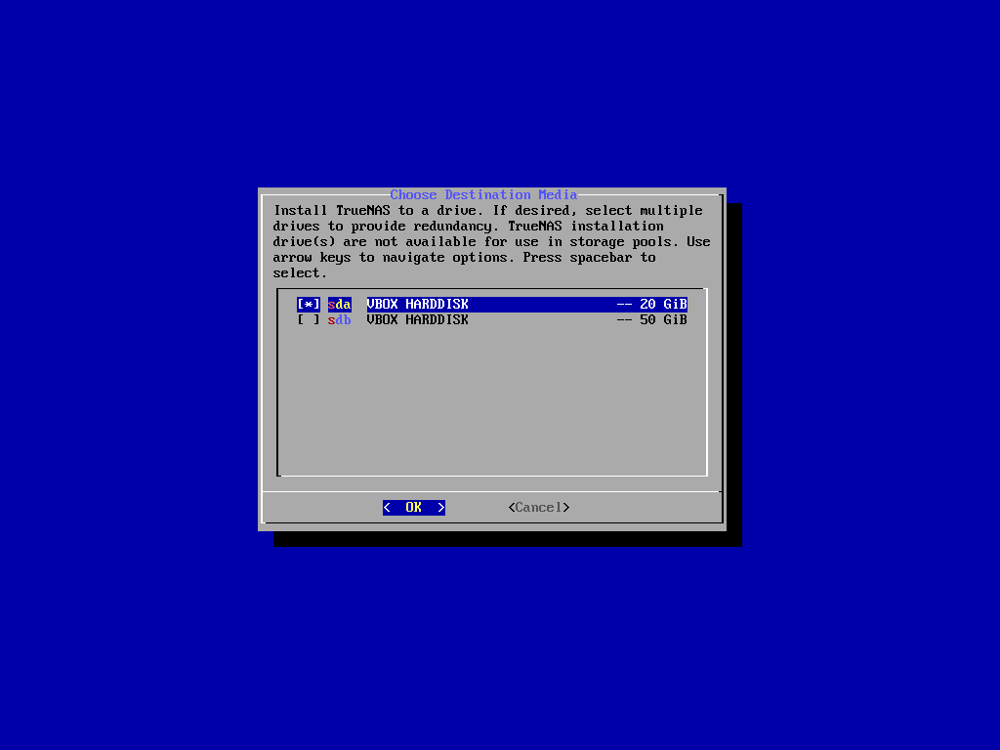
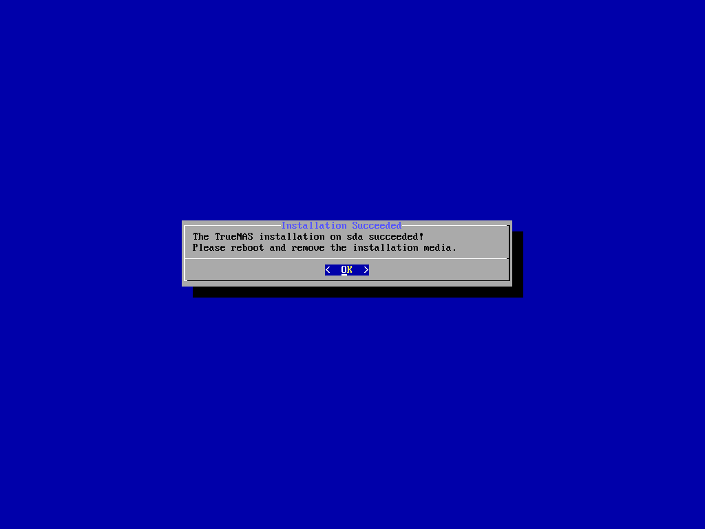
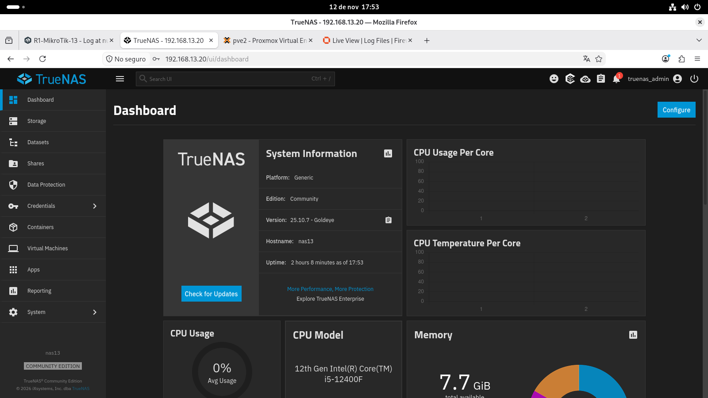
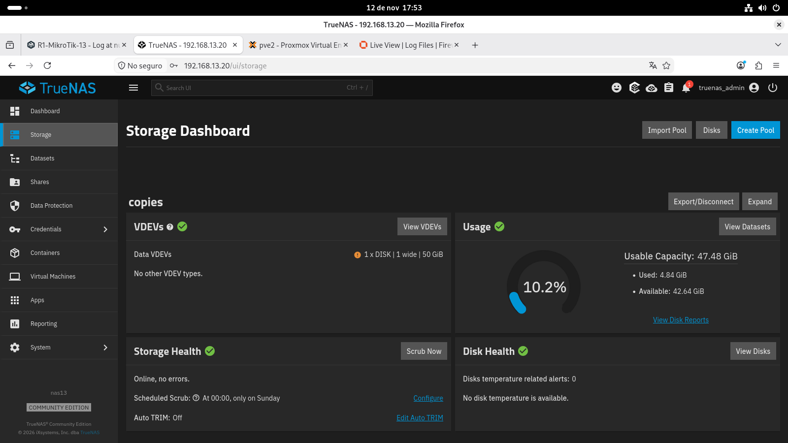
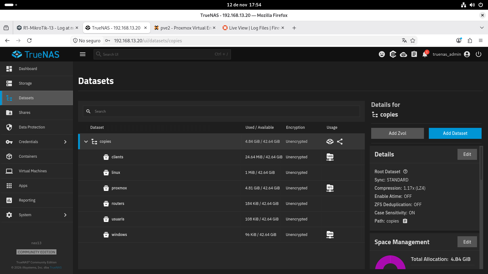
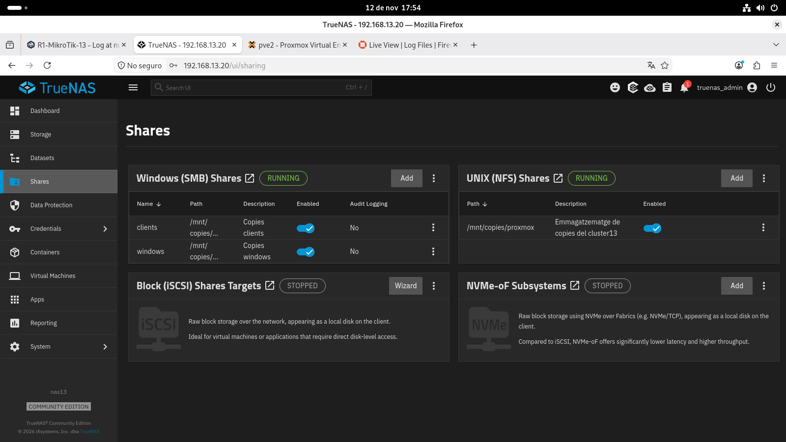
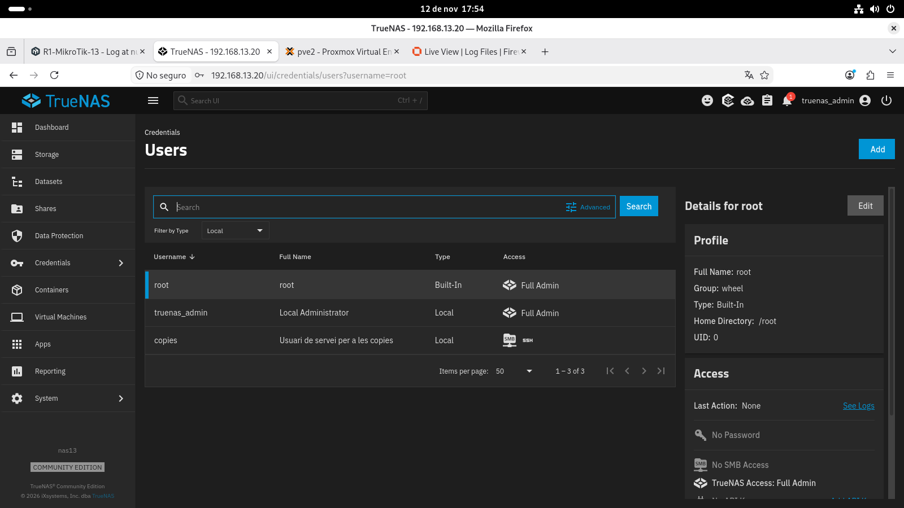
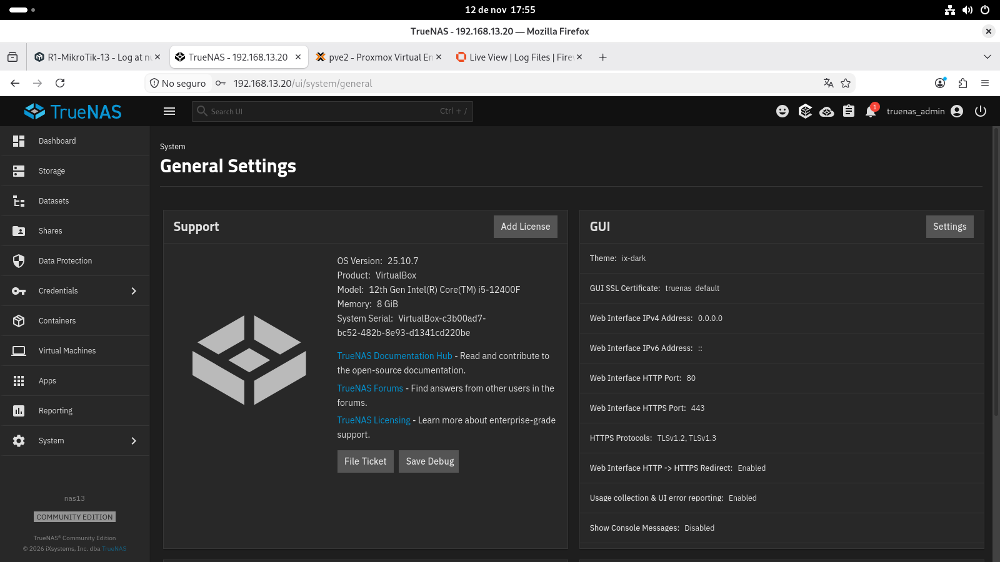

# NAS · TrueNAS SCALE

**a224–a227, a259** · Estat: ✅

| | |
|---|---|
| Versió | TrueNAS SCALE **25.10.7**, instal·lat només al disc de 20 GB |
| Xarxa | **192.168.31.20/24** estàtica, GW i DNS .1, nom `nas31.lan31.local` · web només per HTTPS |
| Usuaris | `truenas_admin` (administrador; root sense contrasenya) · `copies` (no administrador, propietari de les còpies) |
| Pool | **`copies`** sobre el disc de 50 GB (48 GB útils) |

| Dataset | Accés | Ús |
|---|---|---|
| `routers` (r1, r2, r3) | SSH/SFTP | Configuració dels routers |
| `linux` | SSH | `/etc` dels servidors Linux |
| `proxmox` | **NFS** per a 192.168.31.0/24 | `vzdump` i configuració dels nodes |
| `windows` · `clients` | **SMB** | `wbadmin` del WS2025 · còpies dels clients |
| `nas` | SSH | Configuració del propi NAS |

| Acció | Resultat | Evidència |
|---|---|---|
| a224–a227 instal·lació, usuaris, xarxa, disc de còpies | ✅ | [`a224-a227-truenas.txt`](evidencies/a224-a227-truenas.txt) |
| a259 espai de còpies | ✅ què es copia, com i on: [9-Copies](../9-Copies/) | — |

**Lliçó:** després d'un reinici els discos van canviar de nom (`sda` ↔ `sdb`) i TrueNAS va impedir crear el pool sobre el disc del sistema. Els discos s'identifiquen per mida o número de sèrie, no per `sdX`.

## Captures

Captures reals de les VM (MAC tapades). Les fetes abans del 17/11 mostren l'adreçament antic 192.168.13.x.

| Captura | Què demostra |
|---|---|
|  | a224: instal·lació només al disc de 20 GiB |
|  | a224: instal·lació acabada |
|  | a224: panell amb la versió 25.10.7 i el nom `nas13` |
|  | a227: pool `copies` sa (Online, sense errors), 47,48 GiB útils |
|  | a227: datasets `clients`, `linux`, `proxmox`, `routers`, `usuaris` i `windows` |
|  | a227: recursos SMB (`clients`, `windows`) i NFS (`/mnt/copies/proxmox`) actius |
|  | a225: usuaris `root` (sense contrasenya), `truenas_admin` (administrador) i `copies` (només SMB i SSH) |
|  | Seguretat: la web de gestió redirigeix HTTP → **HTTPS** (TLS 1.2/1.3). Des del 12/11 totes les captures de TrueNAS són per HTTPS |
