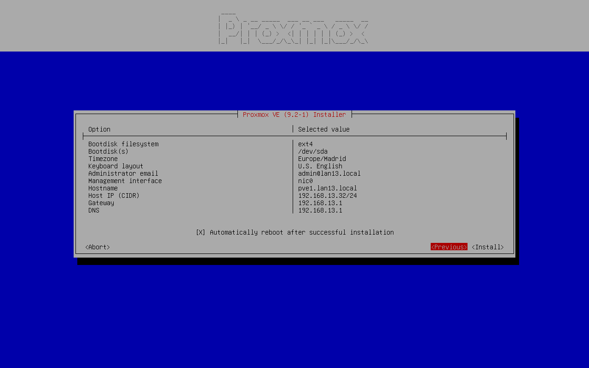
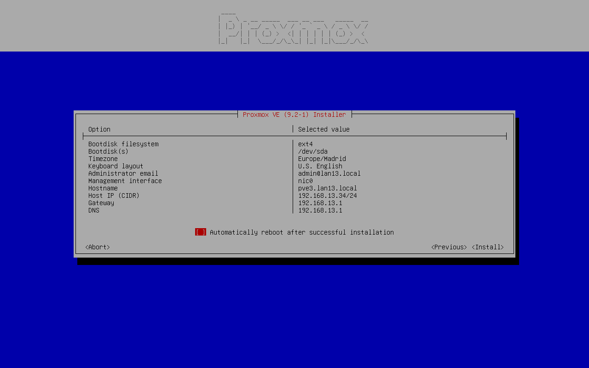
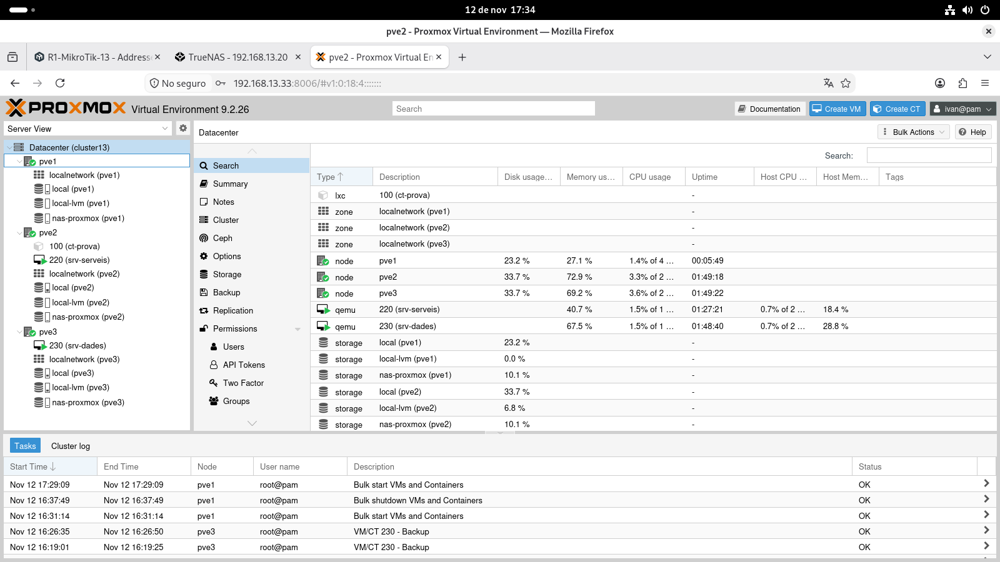
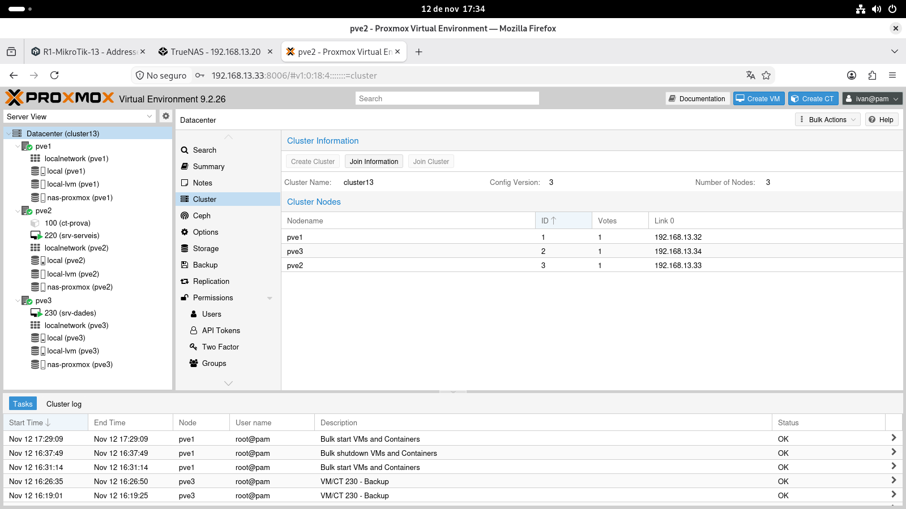
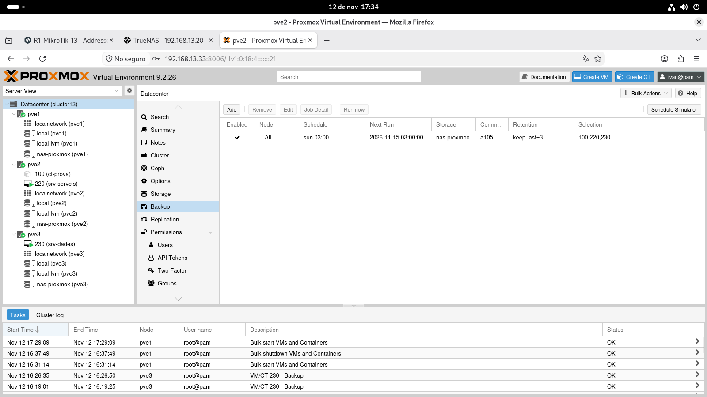
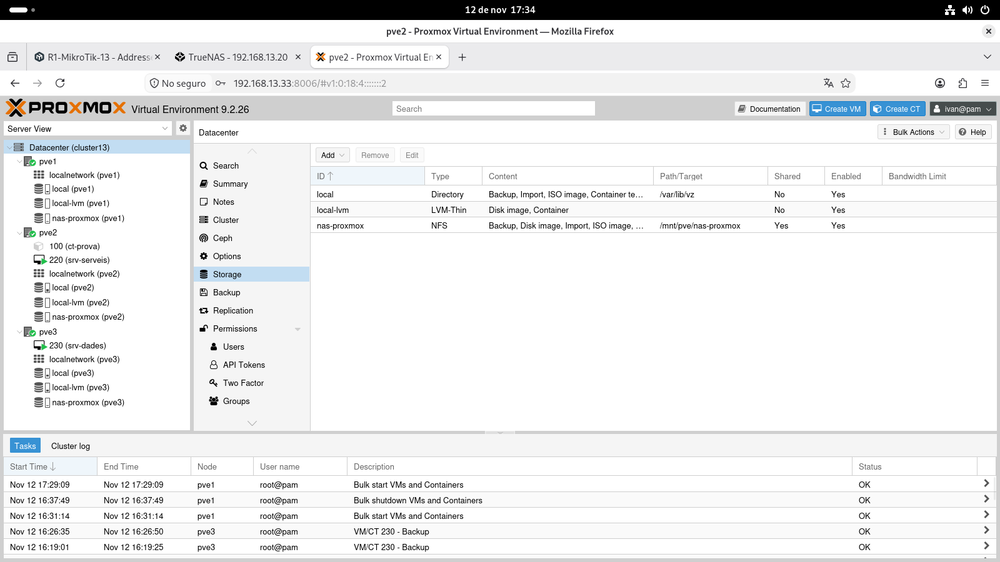
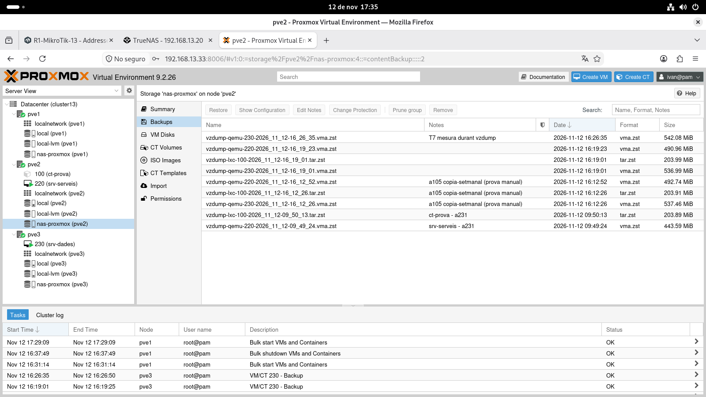

# Proxmox VE · clúster `cluster31`

**a228–a232, a235, a236** · Estat: ✅

| | |
|---|---|
| Versió | Proxmox VE 9.2 · `pve-manager` **9.2.26** (repositori *no-subscription*) |
| Nodes | PVE1 .32 · PVE2 .33 · PVE3 .34 · `vmbr0` sobre `nic0` · 3 GB i 2 vCPU cada un |
| Usuaris | `root@pam` · **`ivan@pam`** (Administrator) · `consulta@pve` (PVEAuditor) |
| Emmagatzematge compartit | `nas-proxmox` (NFS del NAS) visible als 3 nodes |

| Invitat | Node | Funció | IP |
|---|---|---|---|
| VM 220 SRV-SERVEIS | PVE2 | Debian 13 sense GUI: còpies, DRBD node A | .22 |
| VM 230 SRV-DADES | PVE3 | Debian 13 sense GUI: RAID, DRBD node B | .23 |
| CT 100 ct-prova | PVE2 | Contenidor de proves (migració) | .41 |

Les VM es creen des de la imatge cloud oficial de Debian (SHA-512 verificat) amb cloud-init.

| Acció | Resultat | Evidència |
|---|---|---|
| a228 instal·lació i versió | ✅ 3 nodes actualitzats | — |
| a229 usuaris | ✅ | — |
| a230 xarxa | ✅ IP fixa a `vmbr0`, `/etc/hosts` correcte | [Tasca 4](../../Tasca4-Xarxa/evidencies/) |
| a232 clúster i quòrum | ✅ 3 vots, en calen 2; amb un node apagat continua *Quorate* | [`a232-cluster.txt`](evidencies/a232-cluster.txt) |
| a235 migració | ✅ CT 100 (amb reinici) i VM 220 **en calent** | [`a235-a236-migracio.txt`](evidencies/a235-a236-migracio.txt) |
| a236 temps i espai | ✅ vegeu la taula | ídem |
| a231 còpies | ✅ `vzdump` al NAS + configuració dels nodes | — |

| Migració | Temps | Observació |
|---|---|---|
| CT 100 PVE2 ⇄ PVE3 | 87,6 s | Els CT es reinicien |
| VM 220 amb disc local | ❌ falla | Copia els 10 GB i omple el disc del node destí |
| VM 220 amb disc al NFS | **8,5 s**, 50 ms de tall | Només copia la RAM (581 MiB) |

**Conclusió:** amb emmagatzematge compartit la migració només depén de la RAM. **CT vs VM:** el CT comparteix el nucli del node (més lleuger, arrenca en segons); la VM porta el seu nucli (cal per a Windows o més aïllament). **HA:** necessita quòrum i emmagatzematge compartit; aquí queda com a disseny.

## Captures

Captures reals de les VM (MAC tapades). Les fetes abans del 17/11 mostren l'adreçament antic 192.168.13.x.

| Captura | Què demostra |
|---|---|
|  | a228: resum de la instal·lació de PVE1 |
|  | a228: resum de la instal·lació de PVE2 |
|  | a228: resum de la instal·lació de PVE3 |
|  | a232: clúster `cluster13` amb els 3 nodes en línia, la VM 220 a PVE2, la VM 230 a PVE3, el CT 100 i `nas-proxmox` als tres nodes |
|  | a232: 3 nodes, 1 vot cadascun |
|  | a105: tasca de còpia `copia-setmanal` (diumenge 03:00, `keep-last=3`, VM 100, 220 i 230) |
|  | Emmagatzematge `nas-proxmox` (NFS) compartit pels nodes |
|  | a231/a105: còpies `vzdump` al NAS; la retenció ja ha esborrat la còpia més antiga de la VM 230 |
