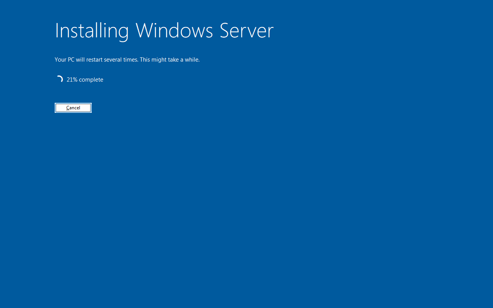
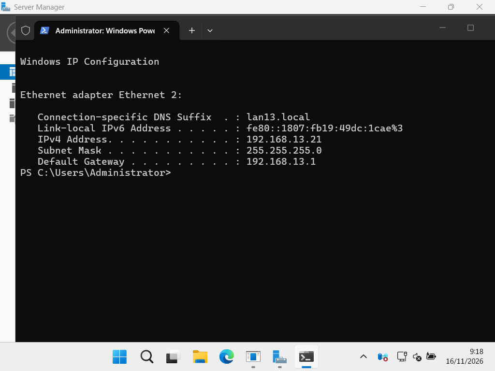
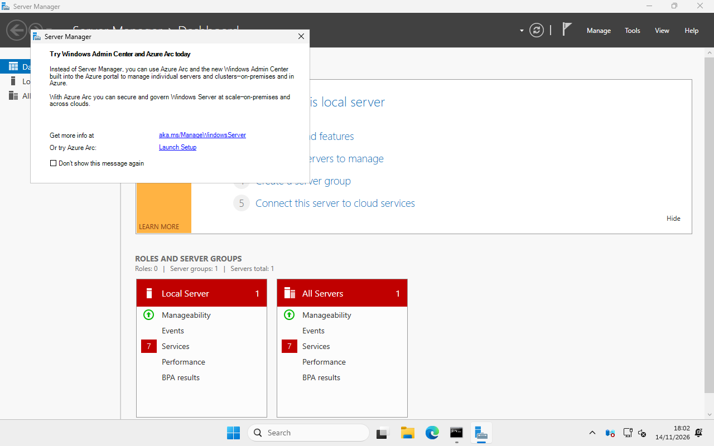
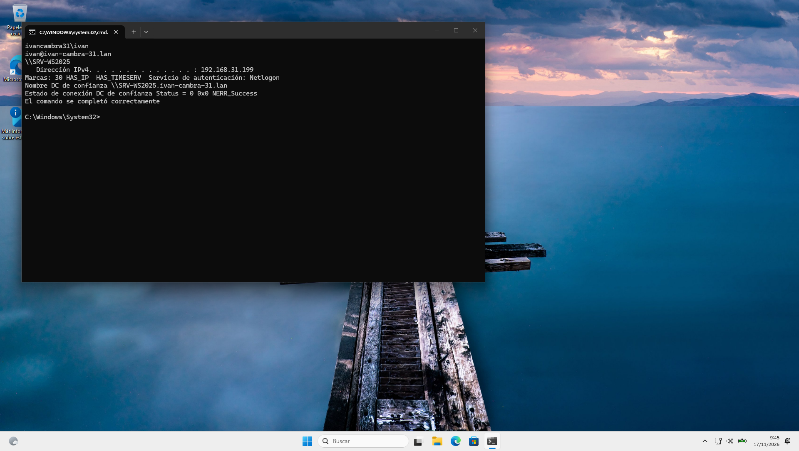
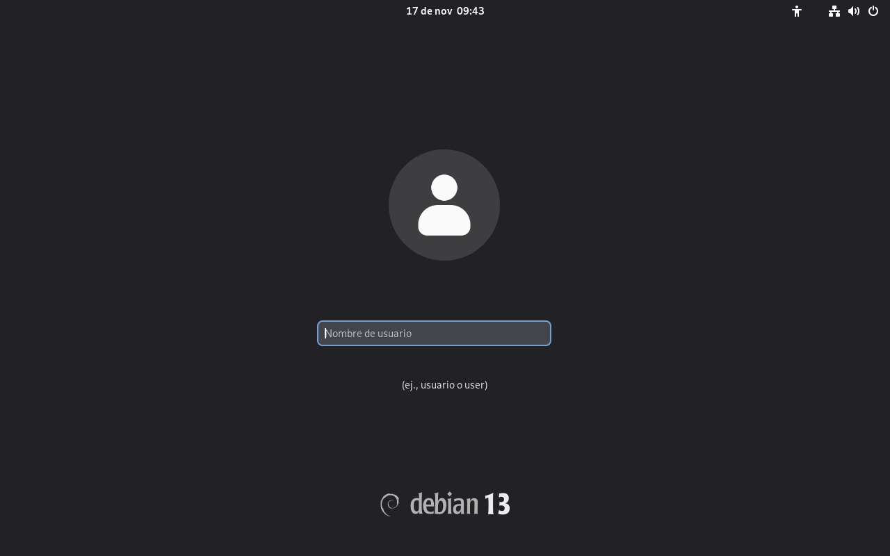
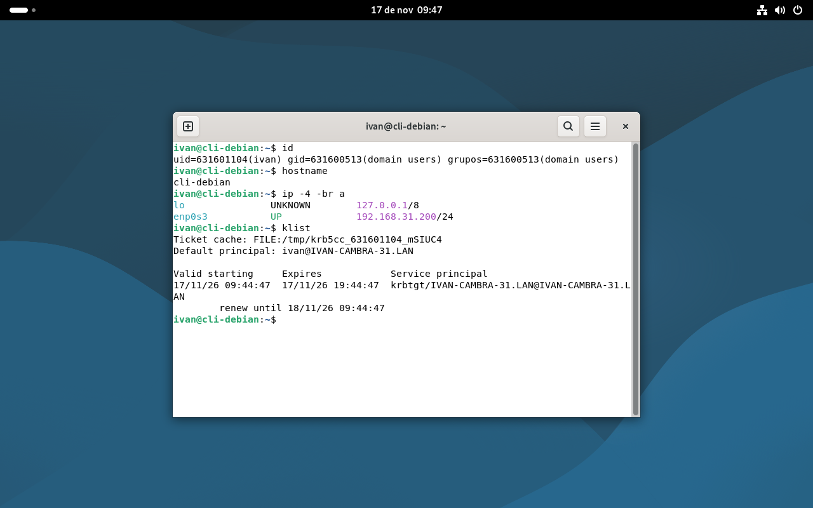

# Windows Server 2025 i domini `ivan-cambra-31.lan`

**a237–a241** (+ domini; a251/a256 no s'exigeixen però s'han fet) · Estat: ✅

| | |
|---|---|
| VM | `SRV-WS2025`, **VM de VirtualBox** (com a l'estructura del professor) · 4 GB · 2 vCPU · EFI · VirtIO |
| Versió | Windows Server 2025 Standard Evaluation (Desktop Experience), compilació **26100.33822** (al dia) |
| Xarxa | **192.168.31.21/24** estàtica (tasca d'inici [`xarxa-inici.ps1`](config/xarxa-inici.ps1)) · DNS 127.0.0.1 i .1 |
| Usuaris | `Administrator` · `admin-ivan` (Administrators) |
| Instal·lació | Desatesa: [`autounattend.xml`](config/autounattend.xml) + [`config-ws2025.ps1`](config/config-ws2025.ps1) |

| Acció | Resultat | Evidència |
|---|---|---|
| a237–a239 instal·lació, usuaris, xarxa | ✅ ping, DNS, HTTPS i SMB al NAS correctes | [`a237-a239-srv-ws2025-virtualbox.txt`](evidencies/a237-a239-srv-ws2025-virtualbox.txt) |
| a240 còpia | ✅ [`ws-copia.ps1`](scripts/ws-copia.ps1): configuració, AD i GPO + `wbadmin` (estat del sistema i volums crítics). **Codi 0**, recuperable fins a *Bare Metal Recovery* i *System State* | [`a240-copia-ws2025-dc-lloc31.txt`](evidencies/a240-copia-ws2025-dc-lloc31.txt) |
| a79 actualització | ✅ acumulativa de novembre, 0 pendents | [`a79-ws2025-windows-update.txt`](evidencies/a79-ws2025-windows-update.txt) |
| a241 domini | ✅ explicació (sota) i domini implantat | [`domini-ivan-cambra-31.txt`](evidencies/domini/domini-ivan-cambra-31.txt) |

**Per què a VirtualBox:** primer es va instal·lar dins de PVE1 (com al grup), però la virtualització niuada (VirtualBox → KVM → Windows) penjava el node. Es va traslladar copiant el disc, sense reinstal·lar.

**Què es copia i què no (a240):** sí l'estat del sistema (en un DC inclou la base de dades d'Active Directory i SYSVOL) i els volums crítics; no el fitxer de paginació, la hibernació ni les dades temporals.

## a241 · Què és un domini i què aporta

*Explicació de l'alumne, ampliada amb ajuda de l'IA:*

> Un domini és una forma d'agrupar de manera lògica els equips, usuaris i recursos d'una xarxa per poder administrar-los tots des d'una única base de dades central (a Windows Server, l'**Active Directory**, que guarda el **controlador de domini**), on es controlen els permisos i la seguretat.
>
> La gestió centralitzada dona molt més control a l'empresa: un usuari entra amb el mateix compte a qualsevol equip, les altes i baixes es fan en un sol lloc, els permisos de les carpetes compartides es donen per grups (per exemple, per departament) i es poden aplicar normes a tots els equips alhora amb les polítiques de grup (GPO).
>
> Ara bé, si l'empresa treballa al núvol o som molt pocs i no tenim restriccions d'accés, personalment crec que no cal muntar un domini local amb servidor propi, i es pot estalviar. Al núvol també hi ha gestió centralitzada (per exemple, Microsoft Entra ID), però sense mantenir el servidor. A l'empresa de l'enunciat, amb cinc departaments, sí que compensa: per això l'he implantat (domini `ivan-cambra-31.lan`, amb els dos clients units; vegeu «Domini» més avall).

## Domini

| Element | Valor |
|---|---|
| Domini / NetBIOS | **`ivan-cambra-31.lan`** / **`IVANCAMBRA31`** (el nom «DC_Ivan_Cambra_31» no és vàlid: el guió baix no es pot usar en DNS) |
| Controlador | SRV-WS2025, bosc nou, DNS integrat a AD |
| Estructura | OU `Usuaris-Lloc31` (usuari **`ivan`**) · OU `Equips-Lloc31` (equips nous) |
| GPO `Lloc31-Inici-de-sessio` | La pantalla demana usuari i contrasenya; sense inici automàtic |
| DNS | R1 reenvia només `ivan-cambra-31.lan` al DC; la resta d'Internet no depén del servidor |
| Contrasenyes | Política de laboratori (curta i sense complexitat): **no és per a una empresa real** |
| Script | [`domini-ivan-cambra-31.ps1`](config/domini-ivan-cambra-31.ps1) (fase 1: crear el bosc · fase 2: DNS, política, OU, usuari, GPO) |

| Comprovació | Windows 11 Pro | CLI-Debian |
|---|---|---|
| Unió al domini | ✅ `nltest` → `NERR_Success` | ✅ `realm list` → `kerberos-member` |
| Pantalla d'inici | ✅ «Iniciar sesión en IVANCAMBRA31» | ✅ GDM demana el nom d'usuari |
| Sessió amb `ivan` | ✅ `ivancambra31\ivan` | ✅ grup `domain users`, tiquet Kerberos |

Els clients s'uneixen amb [`w11-unir-domini.ps1`](../8-Clients/scripts/w11-unir-domini.ps1) i [`cli-unir-domini.sh`](../8-Clients/scripts/cli-unir-domini.sh). **Important:** el servidor s'ha d'engegar just després de R1, abans dels clients.

## Captures

Captures reals de les VM (MAC tapades). Les fetes abans del 17/11 mostren l'adreçament antic 192.168.13.x.

| Captura | Què demostra |
|---|---|
|  | a237 (14/11): instal·lació desatesa de Windows Server a la VM 210 (aleshores dins de PVE1), sense cap pregunta: el disc VirtIO es detecta amb el controlador del CD de virtio-win |
|  | 16/11: SRV-WS2025 ja com a **VM de VirtualBox** (targeta virtio-net «Ethernet 2»): la tasca d'inici ha posat la IP fixa 192.168.13.21/24, GW .1 i sufix `lan13.local` |
|  | a237: primer inici de **SRV-WS2025**: Server Manager obert com a `Administrator`, i el script de primer inici (finestra de consola) configurant VirtIO, l'agent QEMU i la xarxa |
|  | W11 unit al domini: la pantalla d'inici demana usuari i contrasenya i diu «Iniciar sesión en IVANCAMBRA31» (GPO `Lloc31-Inici-de-sessio`) |
|  | Sessió de l'usuari del domini al W11: `whoami` → `ivancambra31\ivan`, UPN `ivan@ivan-cambra-31.lan`, `LOGONSERVER=\\SRV-WS2025`, IP **192.168.31.199** i `nltest /sc_query` → `NERR_Success` |
|  | CLI-Debian unit al domini: GDM demana el nom d'usuari (llista d'usuaris desactivada) |
|  | Sessió gràfica de `ivan` al CLI-Debian: `id` (grup `domain users`), IP **192.168.31.200** i `klist` amb el tiquet de `IVAN-CAMBRA-31.LAN` |
