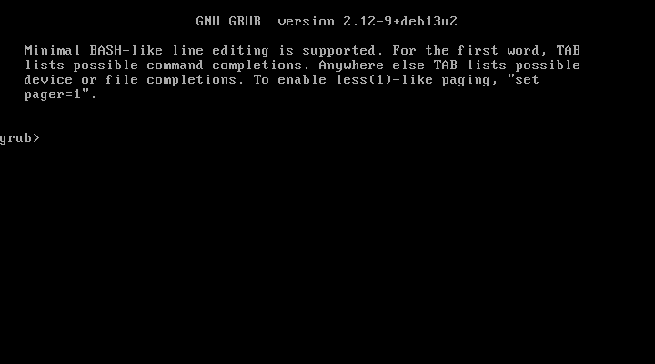
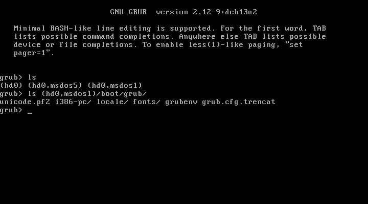
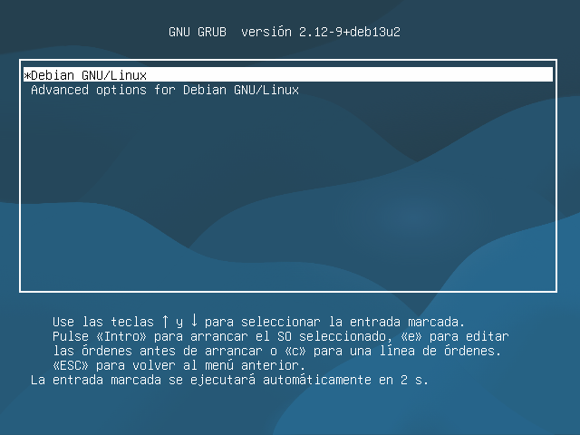

# Servidors GNU/Linux d'infraestructura

**a242–a246** · Estat: ✅ · Configuració aplicada amb [`infra-config.sh`](../5-Proxmox/scripts/infra-config.sh)

| | VM 220 SRV-SERVEIS | VM 230 SRV-DADES |
|---|---|---|
| Node / IP | PVE2 · **.22** | PVE3 · **.23** |
| Sistema | Debian 13.7 sense GUI (imatge cloud oficial, SHA-512 verificat) | ídem |
| Funció | Orquestrador de còpies · DRBD node A | RAID de proves · DRBD node B |
| Usuaris | `ivancambra`, `admin-ivan` (sudo), `suport` · SSH **només amb clau**, root no | ídem |

| Acció | Resultat | Evidència |
|---|---|---|
| a242–a244 versió, usuaris, xarxa | ✅ 0 paquets pendents, IP fixa per cloud-init | [`srv-serveis`](evidencies/a242-a246-srv-serveis.txt) · [`srv-dades`](evidencies/a242-a246-srv-dades.txt) |
| a246 programari | ✅ cap servei addicional (l'enunciat ho diu); només `qemu-guest-agent` | ídem |
| a245 còpia | ✅ `/etc` + llista de paquets al NAS. Prova: s'esborra la configuració SSH i es recupera en **2,8 s** | [`a245-copies-linux.txt`](evidencies/a245-copies-linux.txt) |
| a258 incidència d'arrencada | ✅ GRUB trencat a propòsit al CLI-Debian → arreglat en ≈ 1,5 min | [`incidencia-grub.md`](evidencies/incidencia-grub.md) |

**Què no es copia:** `/usr`, `/var/cache` i els discos de proves del RAID (dades fictícies). Es restaura reinstal·lant, amb `dpkg --set-selections` i descomprimint `/etc`.

## Captures

Captures reals de les VM (MAC tapades). Les fetes abans del 17/11 mostren l'adreçament antic 192.168.13.x.

| Captura | Què demostra |
|---|---|
|  | a258: símptoma, prompt `grub>` |
|  | a258: diagnosi, falta `grub.cfg` |
|  | a258: el menú de GRUB carregat a mà |
