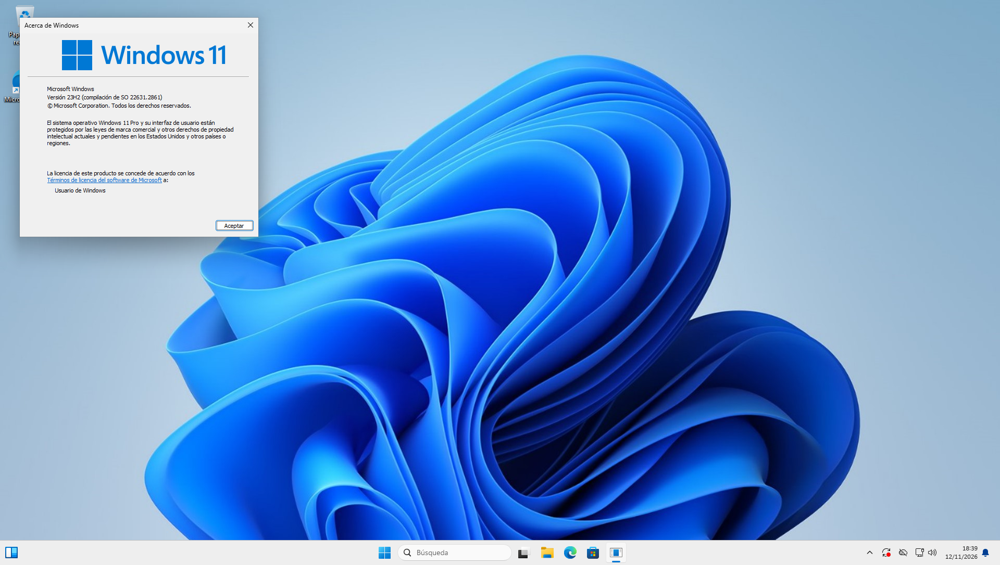
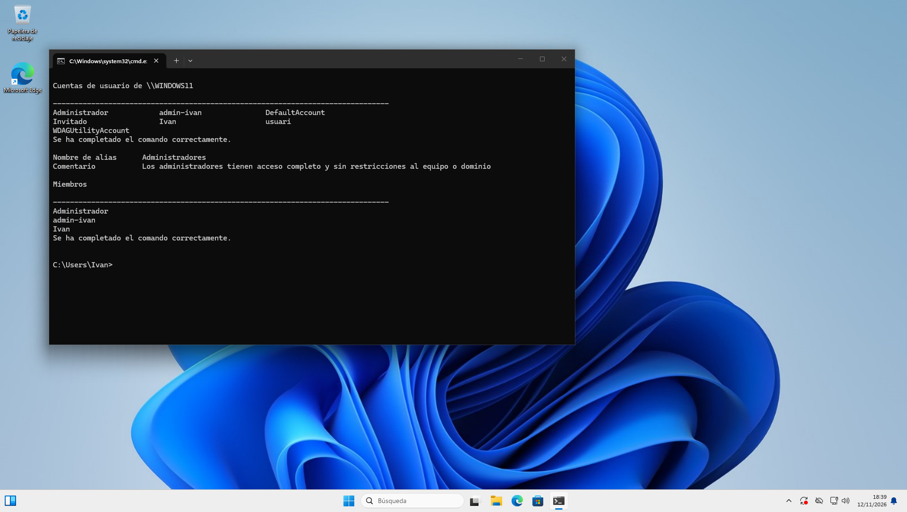
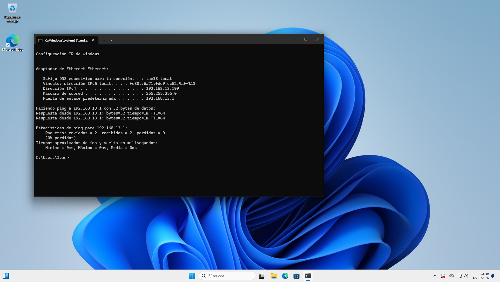
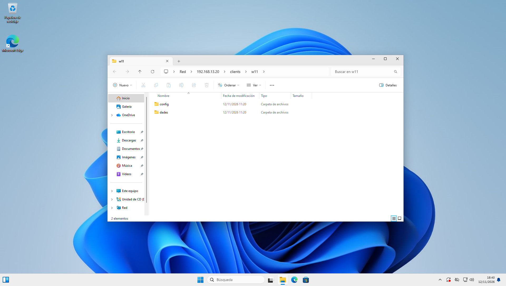
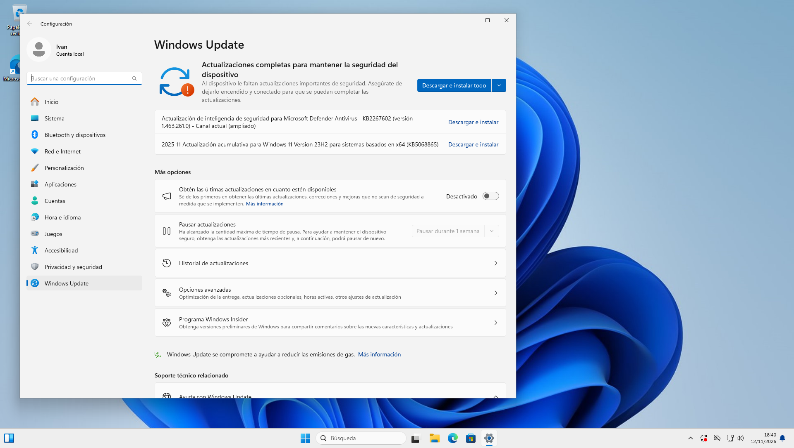
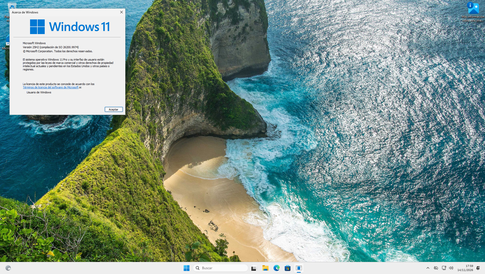
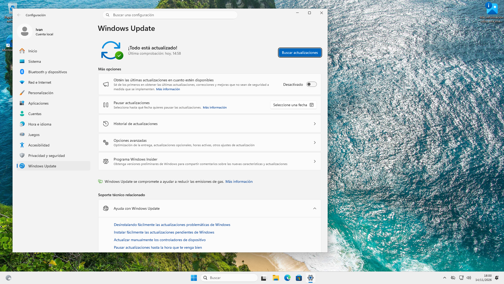
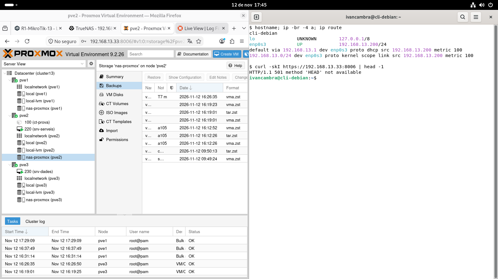

# Clients: Windows 11 Pro i CLI-Debian

**a247–a250, a252–a255** (+ a251/a256: unió al domini, no exigida però feta) · Estat: ✅ · Scripts: [`scripts/`](scripts/)

| | Windows 11 (`Cliente_windows_1`) | CLI-Debian |
|---|---|---|
| Versió (a247/a252) | **Windows 11 Pro 25H2** (26200.9974, al dia) · UEFI, Secure Boot i TPM 2.0 | Debian 13 + GNOME, nucli 6.12.116 |
| Usuaris (a248/a253) | `admin-ivan` (admin) · `usuari` (estàndard) · Administrador i Invitado desactivats | `ivancambra`, `admin-ivan` (sudo) · `usuari` (sense sudo) |
| Xarxa (a249/a254) | DHCP de R1: **.199** | DHCP de R1: **.200** |
| Còpia (a250/a255) | [`copia-w11.ps1`](../9-Copies/scripts/copia-w11.ps1): configuració + Documents i Escriptori de cada usuari al NAS (SMB) · prova de restauració OK | `/home` + `/etc` + paquets al NAS · prova de restauració OK |
| Domini | Unit a `ivan-cambra-31.lan`: s'entra amb `IVANCAMBRA31\ivan` | Unit amb realmd + SSSD: s'entra amb `ivan` |

| Evidència | |
|---|---|
| W11 | [`a247-a249-w11.txt`](evidencies/a247-a249-w11.txt) · [`a247-w11-pro.txt`](evidencies/a247-w11-pro.txt) (Home → Pro) · [`a250-w11-copia.txt`](evidencies/a250-w11-copia.txt) · [`a79-w11-windows-update.txt`](evidencies/a79-w11-windows-update.txt) |
| CLI-Debian | [`a252-a253-cli-debian.txt`](evidencies/a252-a253-cli-debian.txt) · [`a255-cli-debian-copia.txt`](evidencies/a255-cli-debian-copia.txt) |
| Domini | [WS2025 i domini](../6-WS2025-Domini/) |

**Windows 11 Home → Pro:** la VM existent era Home, que no es pot unir a un domini. Es va canviar l'edició *in situ* amb la clau genèrica de Pro (no activa el sistema); es conserven usuaris i dades.

## Captures

Captures reals de les VM (MAC tapades). Les fetes abans del 17/11 mostren l'adreçament antic 192.168.13.x.

| Captura | Què demostra |
|---|---|
|  | a247: `winver`: **Windows 11 Pro**, versió 23H2 (22631.2861) |
|  | a248: usuaris `admin-ivan`, `Ivan` i `usuari`; administradors: `admin-ivan` i `Ivan` (l'`Administrador` integrat està desactivat) |
|  | a249: IP 192.168.13.199/24 per DHCP, porta d'enllaç .1 i ping correcte |
|  | a250: la còpia del client al NAS (`\\192.168.13.20\clients\w11`, carpetes `config` i `dades`), oberta amb l'usuari `copies` |
|  | a79 (12/11, històric): Windows Update **encara tenia pendents** l'acumulativa de novembre de la 23H2 (KB5068865) i una firma de Defender (la 25H2 no es va completar) |
|  | a79 (14/11): `winver`: **Windows 11 Pro 25H2**, compilació 26200.9974 |
|  | a79 (14/11): Configuració → Windows Update: **«¡Todo está actualizado!»** |
|  | CLI-Debian (192.168.13.200, GW .1) amb les quatre webs de gestió obertes: R1, TrueNAS, Proxmox i OPNsense |
