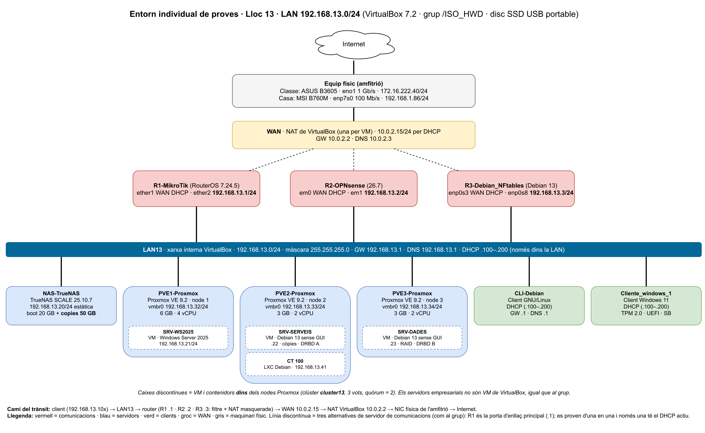

# 03 · Tasca 4 — Esquema de xarxa individual (ISO RA1 · a128, a148, a129, a149)

**Lloc a l'aula: 13 → LAN `192.168.13.0/24`.** La WAN dels routers rep la IP per DHCP del NAT de VirtualBox.
L'adreçament segueix el del [grup 3](https://github.com/varo010/asix-aula-grup-03-ISO/blob/main/docs/04-disseny.md)
(xarxa 192.168.30.0/24): mateixos rangs i mateixos últims octets, però amb el meu tercer octet, **13**.



Font editable: [`diagrames/xarxa-individual-lloc13.drawio`](../diagrames/xarxa-individual-lloc13.drawio) (draw.io).
Es regenera amb [`scripts/vbox/genera-diagrama.py`](../scripts/vbox/genera-diagrama.py).

## 1. Rangs i decisions de disseny

| Rang | Ús (igual que al grup) |
|---|---|
| .1 – .15 | Servidors de comunicacions (R1 .1 · R2 .2 · R3 .3) |
| .16 – .99 | Servidors i serveis amb IP fixa (NAS .20 · WS2025 .21 · serveis .22 · dades .23 · nodes .32–.34 · CT .41) |
| .100 – .200 | Clients per DHCP |
| .201 – .254 | Reserva |

| Decisió | Opcions | Escollida | Per què |
|---|---|---|---|
| Tipus de xarxa per a la WAN | Pont · NAT · Xarxa NAT | **NAT** | No llance res sobre la xarxa compartida de l'aula (172.16.222.0/24) ni sobre la de casa: no hi ha risc de DHCP fals ni de conflictes d'IP. A més, funciona igual als dos equips, encara que tinguen xarxes diferents |
| Tipus de xarxa per a la LAN | Només amfitrió · Xarxa interna | **Xarxa interna `LAN13`** | Aïllada de l'amfitrió i de la xarxa física: l'única eixida és el router. Així es demostra que el filtre funciona |
| IP dels tres routers | La mateixa · una per router | **Una per router (.1, .2, .3)**, com al grup | Poden conviure encesos sense conflicte d'IP. R1 (MikroTik) és la porta d'enllaç principal dels servidors. Quan es prova R2 o R3, el client rep la porta d'enllaç del router actiu per DHCP |
| DHCP | A tots els routers · només a un | **Només a l'actiu** | Dos DHCP a la mateixa LAN es contradiuen. Abans de provar R2 o R3, s'apaga R1 (o se'n desactiva el DHCP) |
| Assignació | Tot estàtic · tot DHCP | **Servidors estàtics, clients per DHCP** (.100–.200) | Els servidors necessiten adreça fixa per a les còpies i la gestió |
| DNS | Públic directe · router | **El router** reenvia a 1.1.1.1 / 9.9.9.9 | Un sol punt de configuració. El grup usa el DNS del centre (172.16.222.1), però amb el NAT de VirtualBox no el necessite |

## 2. Configuració de cada interfície (a148)

Màscara a tota la LAN: **255.255.255.0 (/24)**. La xarxa NAT de VirtualBox és 10.0.2.0/24, amb GW 10.0.2.2 i DNS 10.0.2.3.

| Equip | Nivell | Adaptador | Tipus de xarxa | Interfície (SO) | IP / màscara | Porta d'enllaç | DNS | Mètode |
|---|---|---|---|---|---|---|---|---|
| R1-MikroTik | VirtualBox | 1 | NAT | ether1 (WAN) | 10.0.2.15/24 | 10.0.2.2 | 10.0.2.3 | DHCP |
| | | 2 | Interna LAN13 | ether2 (LAN) | **192.168.13.1/24** | — | — | estàtica · servidor DHCP |
| R2-OPNsense | VirtualBox | 1 | NAT | em0 (WAN) | 10.0.2.15/24 | 10.0.2.2 | 10.0.2.3 | DHCP |
| | | 2 | Interna LAN13 | em1 (LAN) | **192.168.13.2/24** | — | — | estàtica |
| R3 Debian_NFtables | VirtualBox | 1 | NAT | enp0s3 (WAN) | 10.0.2.15/24 | 10.0.2.2 | 10.0.2.3 | DHCP |
| | | 2 | Interna LAN13 | enp0s8 (LAN) | **192.168.13.3/24** | — | — | estàtica |
| NAS-TrueNAS | VirtualBox | 1 | Interna LAN13 | enp0s3 | 192.168.13.20/24 | 192.168.13.1 | 192.168.13.1 | estàtica |
| PVE1-Proxmox | VirtualBox | 1 (promiscu) | Interna LAN13 | vmbr0 (sobre enp0s3) | 192.168.13.32/24 | 192.168.13.1 | 192.168.13.1 | estàtica |
| PVE2-Proxmox | VirtualBox | 1 (promiscu) | Interna LAN13 | vmbr0 (sobre enp0s3) | 192.168.13.33/24 | 192.168.13.1 | 192.168.13.1 | estàtica |
| PVE3-Proxmox | VirtualBox | 1 (promiscu) | Interna LAN13 | vmbr0 (sobre enp0s3) | 192.168.13.34/24 | 192.168.13.1 | 192.168.13.1 | estàtica |
| ↳ 210 SRV-WS2025 | Proxmox (PVE1) | net0 | vmbr0 | Ethernet | 192.168.13.21/24 | 192.168.13.1 | 192.168.13.1 (ell mateix si es promou a DC) | estàtica |
| ↳ 220 SRV-SERVEIS | Proxmox (PVE2) | net0 | vmbr0 | ens18 | 192.168.13.22/24 | 192.168.13.1 | 192.168.13.1 | estàtica |
| ↳ 230 SRV-DADES | Proxmox (PVE3) | net0 | vmbr0 | ens18 | 192.168.13.23/24 | 192.168.13.1 | 192.168.13.1 | estàtica |
| ↳ CT 100 | Proxmox (PVE2) | net0 | vmbr0 | eth0 | 192.168.13.41/24 | 192.168.13.1 | 192.168.13.1 | estàtica |
| CLI-Debian | VirtualBox | 1 | Interna LAN13 | enp0s3 | 192.168.13.100–200/24 | la del router actiu (.1 / .2 / .3) | ídem | DHCP |
| Cliente_windows_1 | VirtualBox | 1 | Interna LAN13 | Ethernet | 192.168.13.100–200/24 | la del router actiu | ídem | DHCP |
| Amfitrió (classe) | físic | — | física | eno1 | 172.16.222.40/24 | N/C | N/C | DHCP de l'aula |
| Amfitrió (casa) | físic | — | física | enp7s0 | 192.168.1.86/24 | 192.168.1.1 | N/C | DHCP del router de casa |

Exemple de configuració estàtica Debian (`/etc/network/interfaces` de SRV-SERVEIS):
```
auto ens18
iface ens18 inet static
    address 192.168.13.22/24
    gateway 192.168.13.1
    dns-nameservers 192.168.13.1
```

Exemple de node Proxmox (`/etc/network/interfaces` de PVE2):
```
auto lo
iface lo inet loopback
iface enp0s3 inet manual
auto vmbr0
iface vmbr0 inet static
    address 192.168.13.33/24
    gateway 192.168.13.1
    bridge-ports enp0s3
    bridge-stp off
    bridge-fd 0
```

## 3. Camí del trànsit

```
SRV-WS2025 (192.168.13.21) ─net0─► vmbr0 de PVE1 ─enp0s3─► LAN13 ─► R1 192.168.13.1
CLI-Debian (192.168.13.10x) ──────────────────────────────► LAN13 ─► router actiu (.1 / .2 / .3)
   router: filtre forward (es permet LAN→WAN excepte tcp/22) + NAT masquerade (origen → 10.0.2.15)
   ─WAN 10.0.2.15─► NAT VirtualBox 10.0.2.2 ─► NIC física (eno1 / enp7s0) ─► router de l'aula/casa ─► Internet
```
- Les VM niuades surten per la NIC del node gràcies al bridge `vmbr0` i a la NIC de VirtualBox en mode promiscu.
- El retorn passa per l'estat de connexió (`established,related`).
- Des d'Internet **no** es pot iniciar res cap a la LAN: hi ha doble NAT (router + VirtualBox) i el router descarta l'entrada per la WAN.

## 4. Implementació i comprovació (Apte+ · a129, a149)

Evidències a `evidencias/t4-xarxa/`, un fitxer per prova i una línia que explique què demostra:

| Prova | Ordre | Des de → cap a | Resultat esperat | Fitxer |
|---|---|---|---|---|
| Configuració d'interfícies | `ip a` · `ipconfig /all` · `/ip address print` | cada equip | IP, màscara, MAC i estat UP | `ifaces-<equip>.txt` |
| Taula d'encaminament | `ip route` · `route print` · `/ip route print` | cada equip | `default via 192.168.13.1` (routers: `via 10.0.2.2`) | `rutes-<equip>.txt` |
| Ping dins la LAN | `ping -c4 192.168.13.20` | CLI-Debian → NAS | 0 % pèrdua, < 1 ms | `ping-lan.txt` |
| Ping a una VM niuada | `ping -c4 192.168.13.21` | CLI-Debian → WS2025 (dins de PVE1) | resposta: el bridge funciona | `ping-niuada.txt` |
| Ping a la porta d'enllaç | `ping -c4 192.168.13.1` | W11 → R1 | 0 % pèrdua | `ping-gw-w11.txt` |
| Eixida a Internet | `ping -c4 1.1.1.1` · `curl -I https://debian.org` | CLI-Debian | resposta | `ping-inet.txt` |
| Resolució DNS | `nslookup debian.org 192.168.13.1` | CLI-Debian | IP resolta pel router | `dns.txt` |
| Traceroute | `traceroute -n 1.1.1.1` · `tracert -d 1.1.1.1` | CLI-Debian / W11 | salt 1 = 192.168.13.1, salt 2 = 10.0.2.2... | `traceroute-*.txt` |
| **Prova que falla a propòsit** | `nc -zv -w5 github.com 22` | CLI-Debian | timeout + línia `BLOQ-SSH` al registre del router | `bloquejada.txt` |
| Aïllament | `ping -c3 192.168.13.20` i `ip route get 192.168.13.20` | amfitrió → NAS | **falla**: l'amfitrió (i, per tant, l'aula) no té cap ruta cap a LAN13; només s'hi entra a través del router | `aillament.txt` |
