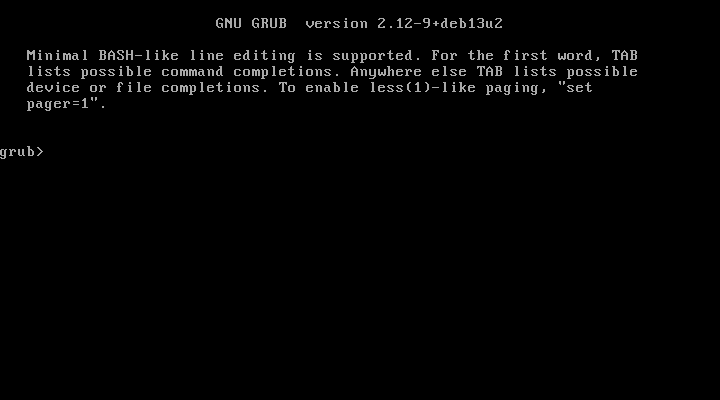
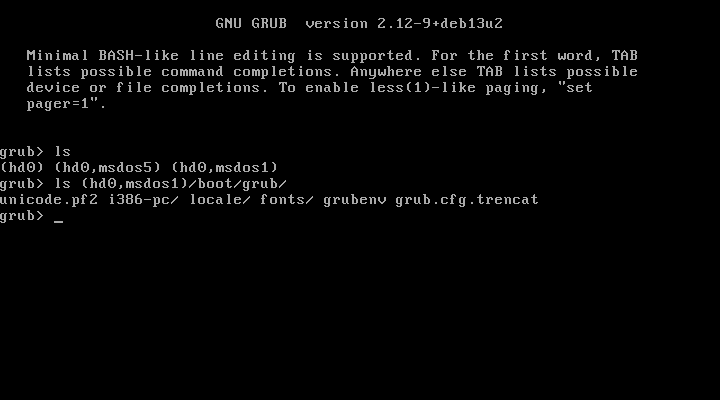
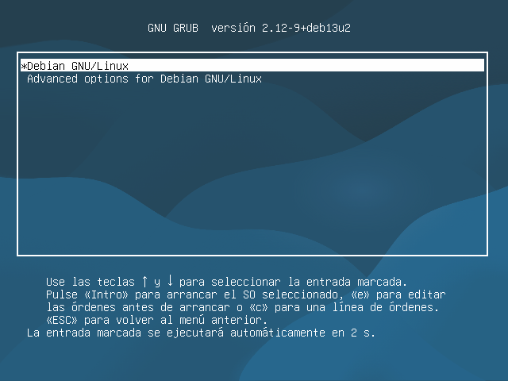

# a258 · Incidència d'arrencada provocada: GRUB sense configuració (CLI-Debian, 12/11/2026)

**Punt de retorn:** instantània de VirtualBox `CLI-abans-incidencia-grub`.
**Avaria provocada:** `mv /boot/grub/grub.cfg /boot/grub/grub.cfg.trencat` i reinici (16:18:02).

| Pas del mètode | Què es fa | Resultat |
|---|---|---|
| 1. Símptoma | L'equip no arriba al menú de GRUB ni al sistema | Prompt `grub>` («Minimal BASH-like line editing») →  |
| 2. Hipòtesi | GRUB (fase 1 i 2) es carrega, però no troba `grub.cfg`. Alternativa: disc o partició danyats | — |
| 3. Prova que les distingeix | `ls` i `ls (hd0,msdos1)/boot/grub/` | Es veuen el disc i les particions, i el directori de GRUB **existeix** però no té `grub.cfg` (només `grub.cfg.trencat`) → no és el disc, és la configuració →  |
| 4. Solució temporal | `configfile (hd0,msdos1)/boot/grub/grub.cfg.trencat` | Apareix el menú i el sistema arrenca → . SSH torna a respondre a les **16:19:35** |
| 5. Solució definitiva | `sudo update-grub` (regenera `/boot/grub/grub.cfg`) i s'esborra el fitxer trencat | `grub.cfg` nou (8 607 bytes) |
| 6. Prova funcional | Reinici sense tocar res | Arrenca sol en **35 s** fins a SSH |

**Temps d'inactivitat:** ≈ **1,5 min** des del reinici fins que el sistema torna a funcionar (amb la solució temporal), sabent ja què fer.
Sense conéixer l'ordre `configfile`, l'alternativa seria arrancar des de la ISO de Debian en mode *rescue*, muntar `/` i executar `update-grub` (≈ 10 min).

**Configuracions crítiques d'arrencada** (es copien amb `/etc` al NAS, a255): `/etc/default/grub`, `/etc/fstab` i el mateix `/boot/grub/grub.cfg`, que es regenera amb `update-grub`.
